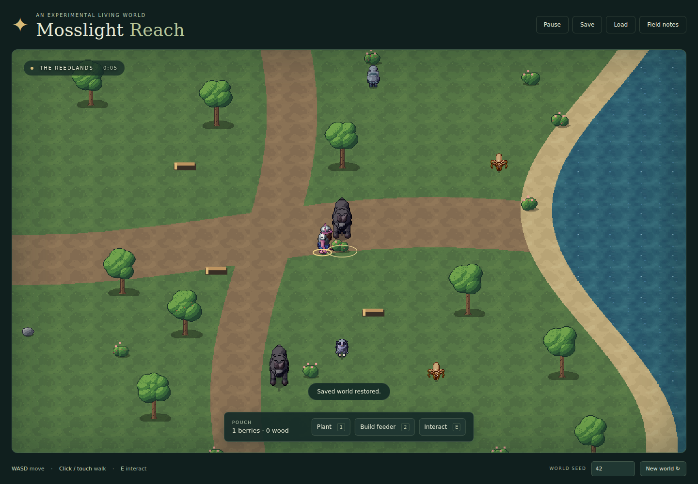

# Mosslight Reach

A small, playable procedural world—and the first experiment in **RPG-test**. Explore a wetland, watch its independent foragers, and change where food grows. This is a foundation for discovering the eventual game, rather than a commitment to a particular RPG genre.



## Play locally

Requires **Node.js 24** (tested with 24.22.1).

```sh
npm ci
npm run dev
```

Open the local URL printed by Vite. The checked-in generated artwork makes .NET unnecessary for playing or building the browser game. No accounts, API keys, remote fonts, or game servers are required.

- **WASD / arrows:** move. **Click or touch:** walk to a destination or select an object.
- **E / Interact:** pick a berry, gather fallen wood, stock a feeder, or inspect a creature. Move within reach first.
- **1 / Plant:** spend one berry to establish a patch on open ground to your right. Its first fruit ripens after 20 simulation seconds.
- **2 / Build feeder:** spend three wood to build a station. Interact with it while carrying berries to stock it.
- **Field notes:** inspect motives, hunger, meals, and the causal event history.
- **Save / Load:** store and restore one world in this browser's local storage. New World leaves that save intact.
- **Pause / Escape:** stop time. Loading and changing seeds do not dismiss the introduction; press Explore to start.

Try leaving food in a new place and observing who uses it. Picking every berry leaves fewer opportunities for other foragers. Patches regrow, and hungry creatures reconsider depleted destinations. Winged anatomy permits water crossings; ground creatures must find land routes. There is no win screen, combat, or death in this milestone.

Touch uses tap-to-walk and on-screen action buttons. The 390 × 844 layout is browser-tested; actual phone performance and device ergonomics remain unverified. Trees are non-blocking scenery.

## Build, test, and regenerate

```sh
npm test                 # generation, actions, NPCs, persistence, asset integration
npm run build            # dist/; portable relative URLs
npx playwright install chromium
npm run test:e2e          # launches the production preview itself; browser controls and screenshots
npm run benchmark        # seeded simulation + generation/save/load measurements
npm run preview          # serve the production build manually
```

Artwork regeneration additionally requires a **.NET 8 SDK**:

```sh
npm run art
npm test
npm run build
```

The exporter automatically locates the installed SDK and compiles the vendored PPC core with its C# compiler. It needs no NuGet packages and downloads no tools. A custom installation can use `DOTNET_ROOT` or `DOTNET_HOST_PATH`. Conventional `dotnet run --project tools/art -c Release -- public/art` is also supported. See [the artwork pipeline](docs/ART.md).

## What is simulated

Eight persistent agents have hunger, destinations, and different anatomical locomotion capabilities. They search available sources, route to them, consume shared food, rest, and search again. The player's harvesting, planting, and feeding actions modify exactly those resources. Events describe actual mutations, not invented stories. Agent choices are deterministic and explainable; there is no language-model service.

This is a small resource-and-attraction sandbox. The emergent part is **which agent gets which food, when it must change destination, and how player-created sources redirect it**. Hunger thresholds, regrowth, world composition, starting identities, and action recipes are authored rules. There is no civilization, evolutionary model, dialogue, or procedural quest generator hiding behind the presentation.

## Technology and evidence

Browser Canvas 2D + plain JavaScript, Vite, and PPC's original .NET core. Five generated creature identities across four families, 640 exported animation frames, eight facings, and compatible PPC environment art. Runtime dependencies: none. [Engine decision and candidate investigation](docs/DECISIONS.md) · [architecture](docs/ARCHITECTURE.md) · [dependency register](THIRD_PARTY_NOTICES.md) · [validation report](docs/VALIDATION.md) · [next experiments](docs/ROADMAP.md).

GitHub Actions validates code, regenerates the artwork, builds, and runs Chromium against the actual production build. A separate Pages workflow publishes **after a merge to main** or manual dispatch; it needs GitHub Pages configured to use GitHub Actions. No public deployment is claimed until its workflow and URL have been verified. The feature pull request is intentionally left unmerged.

Project code is MIT. Procedural Pixel Creatures is by **idlerunner00**; its MIT license and embedded third-party notices are retained under `vendor/ppc/`.
