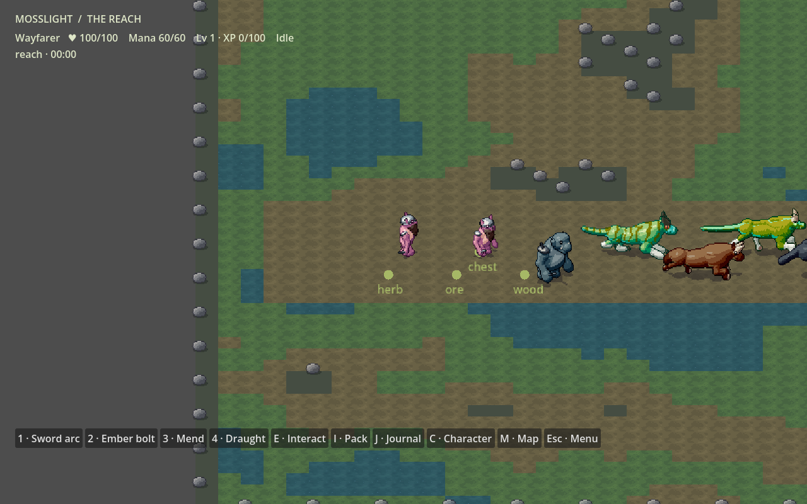

# Mosslight — procedural fantasy RPG foundation

Godot **4.6.1 .NET** / **.NET SDK 9.0.203** (desktop net8.0 / Android net9.0). One native 2D runtime integrating PPC creatures, Gloot inventory/equipment, SPELL abilities, Dialogue Manager 4, QuestSystem, Skelerealms planning and Graph Dungeon Generator.



## Play on Android

[Download, install and play from your phone](docs/ANDROID_DEVELOPMENT.md). GitHub Actions builds a signed ARM64 APK for each PR/branch update. No desktop setup is required for phone testing.

## Start

Install Godot **.NET**, the pinned SDK and Python 3. From the repository root:

```sh
dotnet build
python3 tools/import-project.py
godot --path .
```

Set `GODOT` to your executable path for the Python commands if needed. Open `project.godot` in the .NET editor and press F6/F5, or run the command above. Choose **Enter / Resume**. C# web export is not supported by this engine; this project targets Android and native desktop. Android, Linux and Windows export presets are provided.

**WASD** moves with terrain collision. **1 / 2 / 3** use melee, ember and healing abilities; **Space** dodges; **4** consumes a draught. **E** interacts with nearby resources, chests, fallen enemies, wardens and portals. **I / C / J / M** open inventory, character, quest journal and map. **Escape** opens pause/save/load/settings. Sword attacks can be made in any direction without a target; enemies are checked in the facing arc at impact. Other targeted abilities retain their existing targeting.

Visit a warden for actual branching dialogue and quests. Equip armour, craft a draught or buy merchant stock through the pack panel. The eastern portal opens a seeded dungeon with keys, locked corridors, creatures and a relic. The development menu exposes creature generation/mutation/export, region transitions, diagnostics and the production integration suite. This is an engineering test environment, not a finished game or a balanced adventure.

## Verify and author

```sh
python3 tools/verify.py --headless  # actual Godot/C#/GDScript integration tests + benchmarks
python3 tools/verify.py --visual    # real display required; input, dialogue choices, UI, screenshots
python3 tools/pack-dungeon-rules.py # after grammar edits
node tools/export-art.mjs /tmp/ppc-catalog --all --seed=42
```

The native game generates arbitrary registered PPC genomes live, stores full genomes in saves, and uses the original bounded model cache/render queue. The offline exporter remains available without Godot or NuGet. See [tool commands](tools/README.md).

[Combat controls](docs/COMBAT_CONTROLS.md) · [Architecture](docs/ARCHITECTURE.md) · [engine decision](docs/ENGINE_DECISION.md) · [integration ownership](docs/INTEGRATION_MAP.md) · [content authoring](docs/CONTENT_AUTHORING.md) · [art pipeline](docs/ASSET_PIPELINE.md) · [tests and evidence](docs/TESTING.md) · [migration](docs/MIGRATION.md) · [roadmap](docs/ROADMAP.md) · [source audit](docs/SOURCE_AUDIT.md) · [dependency register](docs/UPSTREAM_DEPENDENCIES.md).

The previous browser ecology experiment lives only under `examples/mosslight/`, is excluded from Godot, and retains its useful tests. It is a reference tool, not another supported game runtime. The old Pages deployment workflow has been removed. Project code and the imported systems are MIT; complete third-party notices and source modifications are retained.
