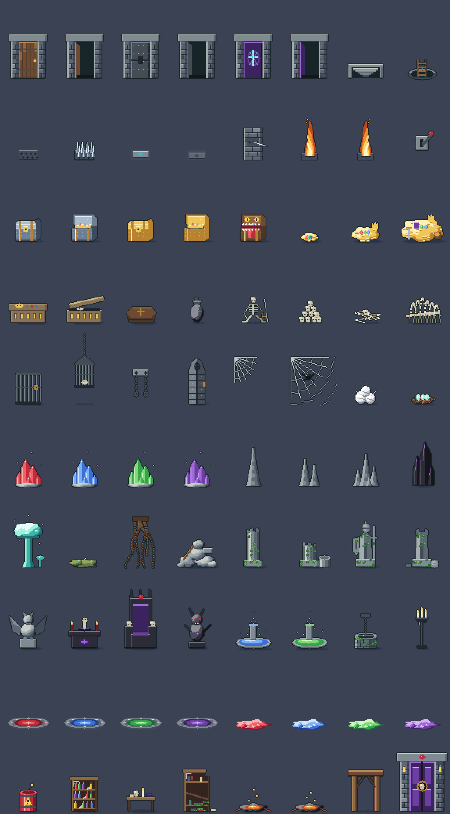
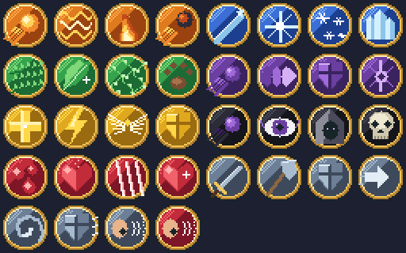

# Asset library

Nearly a thousand procedurally painted modules for future content, in the Living Reach's manner: the same indexed palette, upper-left light, one dark contour and a cast shadow. Every module is a recipe in `game/assets/`; nothing is a hand-edited file, so the whole library re-renders identically from source.

The 248 **Keep** modules now have placements in the game across the generated Reach and its ruins. The catalog retains the other designs for future review.

## Mosslight fit review

The [curated catalog](asset-library/curation.csv) gives all 996 modules a decision and reason. It covers the library introduced in PR #10 and carried into PR #11. The review compares the sheets with the Living Reach, its modest town interiors and ruins, and the current mobile HUD. It rates whether an asset belongs on the shortlist. The table describes the review decisions. Animated families count once per frame.

| Decision | Modules | Use |
| --- | ---: | --- |
| Keep | 248 | Shortlist for the current setting. Start with mossy stone, cairns, hollow logs, weathered shrines, simple work furniture, cave rubble and nests. |
| Reserve | 333 | Save for a specific region, room, item or mechanic. Frost trees, palms, cacti, coral, docks, mine gear and traps belong here. |
| Rework | 392 | Adapt to Mosslight before use. Tone down jewel-bright magic props, give recoloured items distinct silhouettes, and match combat cues and interface art to the live game. |
| Exclude | 23 | Leave these versions out of content briefs and placement shortlists. |

### Exclude from the shortlist

| Sheet | Module IDs | Reason |
| --- | --- | --- |
| Biomes | `snowman` | Seasonal novelty prop. |
| Structures | `sandbags` | The stacked military barrier feels out of place alongside the Reach's timber and fieldstone defenses. |
| Landmarks | `lighthouse` | The striped tower and hard beacon cone read as a modern coastal beacon. A stone signal tower could serve a future coast. |
| Furnishings | `piano`, `floor-lamp` | These upright piano and shaded standing-lamp designs look out of period in the current interiors. The harp and candelabra suit specialist rooms. |
| Delve | `iron-maiden` | A torture-device prop pushes the ruins toward a different tone. |
| Materials | `bone-floor` | Repeating skulls overwhelm the floor pattern. Use sparse bone props on stone. |
| Effects | `coin-spin-1` through `coin-spin-8` | The arcade reward animation competes with the game's quieter looting feedback. |
| Items | `heart`, `star` | Generic pickup symbols carry little meaning as inventory items. |
| Interface | `cursor-hand`, `cursor-sword`, `cursor-target`, `cursor-grab`, `speech-bubble`, `thought-bubble` | Desktop pointers and comic bubbles clash with the established touch controls and dialogue presentation. |

The streamed Reach uses contextual pines, flowers, shore props and small landmarks. Camps, memorials and stone markers use material accents and the existing reduced-motion clock. The generated town uses the furniture in its six house styles, with the item art arranged as local goods on display. Existing inventory items use five of those icons directly. The dungeon keeps its original layout and uses the reviewed clutter along room edges and the torch frames on its wall sconces. The mine and cave artwork depict blocked openings. Purchases, equipment, dungeon entrances and collision continue to use the existing rules.

`AssetLibraryChecks` checks the live placement rules across eight seed worlds against every Keep ID, including the animation frames.

Keep a full animation together when applying a decision. The catalog deliberately lists every frame so it can be joined directly to `manifest.json` by sheet and module name. When adding or renaming a recipe, review its catalog row alongside the next asset export.

## Using it

- **In the game:** `AssetLibrary.Draw(canvas, "tree-autumn-1", foot)` draws a module with its ground contact at `foot`. `AssetLibrary.Texture(sheet)` gives the sheet texture (built once) and `sheet.Source(index)` its rectangle; `AssetLibrary.TryFind(name, ...)` looks a module up.
- **Outside the game:** `godot --headless --path . -- --export-assets` writes every sheet to `docs/asset-library/` as a PNG, a 2x preview on a neutral ground (`*-preview.png`), `manifest.json` (each module's sheet, rectangle, pivot and whether it lies flat) and `palette.json`.
- **Pivots:** standing modules in 72x104 cells have their foot at (36,100), as the Reach props do; landmarks at (80,172); icons, effects and interface pieces are centred.

## Sheets

### items (272)

Item icons, 24x24: weapons and armour in bronze, iron, steel, gold and mythril; potions, gems, staves, books, scrolls and more in eight hues; bows, tools, food, materials, trophies and valuables.

### biomes (100)

Nature for lands beyond the Reach, 72x104: autumn, golden, blossom, mystic, swamp and frost trees; snowy pines, dead trees, palms, willows, bamboo; desert, snow, stone, flowers, giant mushrooms, swamp and coast pieces; crops in growth stages.

### structures (92)

Things built out in the world, 72x104: tents, campfires (4 frames), graves, shrines, waystones, portals, pylons, rune circles, standards, totems; bridges, docks and boats; palisades and defences; farm, mine and market gear.

### landmarks (16)

Large set pieces, 160x176: windmill (2 frames), watchtower, lighthouse, mine entrance, cave mouth, great tree, ruined temple, wizard tower, castle gate, sailing ship, war tent, stone bridge, colossus head, dragon bones, great crystal.

### furnishings (88)

Interiors, 72x104: beds, wardrobes, chairs, tables, desks, workbench, bar, kegs, oven, cauldrons (2 frames), fireplaces (4 frames), bookcases, shop shelves, clock, mirror, lamps, piano, harp, globe, loom, throne, armour stands, curtains, carpets, paintings.

### delve (80)

Dungeon pieces, 72x104: doors (wood, iron, rune; shut and open), stairs, traps, flame jets, chests and a mimic, treasure piles, sarcophagi, bones, cages, webs, crystal clusters, stalagmites, statues, gargoyle, dark altar and throne, springs, teleporters, slime pools, boss door.

### effects (224)

Animated effects, 48x48, eight frames each (name-1 to name-8): explosion, fire/frost/arcane burst, smoke, dust, sparkles, slash, hit spark, heal, level-up, lightning, splash, ripple, poison, portal swirl, shield, ice shards, leaves, missile, teleport, coin spin, torch flame, curse, blood, embers, snowfall.

### materials (32)

Seamless ground materials, 48x24 (two tiles in the ground projection), tile at both edges: snow, ice, sand, dunes, mud, swamp/shallow/deep water, lava, basalt, ash, obsidian, cobble, flags, sandstone, brick, planks, parquet, marble, checker, carpets, straw, tilled soil, grasses, leaf litter, gravel, moss stone, crystal floor, grate, bone floor.

### abilities (36)

Ability icons, 32x32 on a medallion coloured by school: fire, frost, nature, arcane, holy, shadow, blood and steel.

### interface (56)

Interface pieces, 48x48: nine-slice panels in eight styles (12-pixel border), buttons and pressed states, item slots by rarity, round slot, bars, divider, ornament, tab, cursors, arrows, speech and thought bubbles, quest marks, status glyphs, map markers.

## Extending it

Add a recipe to the sheet's class with `sheet.Add(name, p => ...)`, painting with `OverworldPropArt.Pixels` (`Blob`, `Trunk`, `Tier`, `Poly`, `Line`, `Oval`, `Cast`, `Tuft`) and the helpers in `Brush` (`Box`, `Masonry`, `Planks`, `Cylinder`, `Flame`, `Pitch`, `Window`, `Door`, `Moss`). Name colours through `AssetPalette` ramps rather than raw indices. Palette indices 95-166 were added for this library; their families are listed in `OverworldPropArt.Palette`.

`AssetLibraryChecks` (headless) requires every module to be painted, to use only the shared palette, to repeat exactly, to have a unique name and a pivot inside its cell, to keep a transparent gutter unless it lies flat, materials to be opaque, and every effect to have eight frames. Effects may hold a blank frame for a flicker or the end of a fade.

The catalog previews show the original sheets at 2x.
