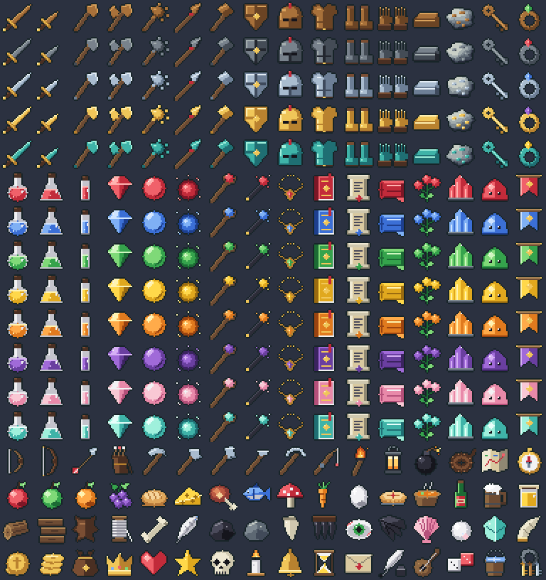
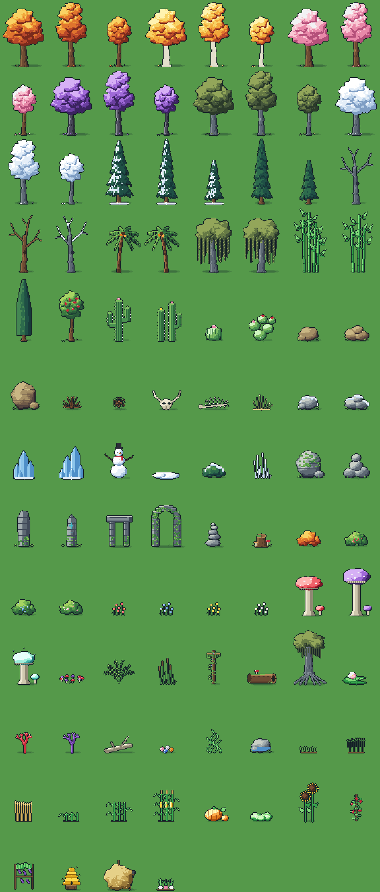
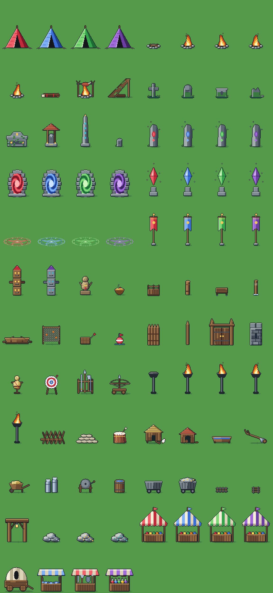
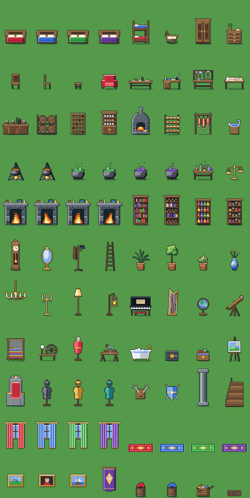
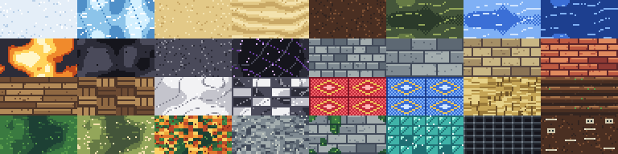
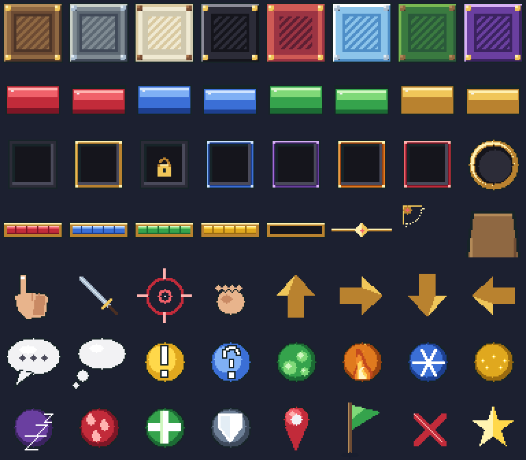

# Asset library

Nearly a thousand procedurally painted modules for future content, in the Living Reach's manner: the same indexed palette, upper-left light, one dark contour and a cast shadow. Every module is a recipe in `game/assets/`; nothing is a hand-edited file, so the whole library re-renders identically from source.

None of it is placed in the game yet. It is a library to draw from.

## Using it

- **In the game:** `AssetLibrary.Draw(canvas, "tree-autumn-1", foot)` draws a module with its ground contact at `foot`. `AssetLibrary.Texture(sheet)` gives the sheet texture (built once) and `sheet.Source(index)` its rectangle; `AssetLibrary.TryFind(name, ...)` looks a module up.
- **Outside the game:** `godot --headless --path . -- --export-assets` writes every sheet to `docs/asset-library/` as a PNG, a 2x preview on a neutral ground (`*-preview.png`), `manifest.json` (each module's sheet, rectangle, pivot and whether it lies flat) and `palette.json`.
- **Pivots:** standing modules in 72x104 cells have their foot at (36,100), as the Reach props do; landmarks at (80,172); icons, effects and interface pieces are centred.

## Sheets

### items (272)

Item icons, 24x24: weapons and armour in bronze, iron, steel, gold and mythril; potions, gems, staves, books, scrolls and more in eight hues; bows, tools, food, materials, trophies and valuables.

### biomes (100)

Nature for lands beyond the Reach, 72x104: autumn, golden, blossom, mystic, swamp and frost trees; snowy pines, dead trees, palms, willows, bamboo; desert, snow, stone, flowers, giant mushrooms, swamp and coast pieces; crops in growth stages.

### structures (92)

Things built out in the world, 72x104: tents, campfires (4 frames), graves, shrines, waystones, portals, pylons, rune circles, standards, totems; bridges, docks and boats; palisades and defences; farm, mine and market gear.

### landmarks (16)

Large set pieces, 160x176: windmill (2 frames), watchtower, lighthouse, mine entrance, cave mouth, great tree, ruined temple, wizard tower, castle gate, sailing ship, war tent, stone bridge, colossus head, dragon bones, great crystal.

### furnishings (88)

Interiors, 72x104: beds, wardrobes, chairs, tables, desks, workbench, bar, kegs, oven, cauldrons (2 frames), fireplaces (4 frames), bookcases, shop shelves, clock, mirror, lamps, piano, harp, globe, loom, throne, armour stands, curtains, carpets, paintings.

### delve (80)

Dungeon pieces, 72x104: doors (wood, iron, rune; shut and open), stairs, traps, flame jets, chests and a mimic, treasure piles, sarcophagi, bones, cages, webs, crystal clusters, stalagmites, statues, gargoyle, dark altar and throne, springs, teleporters, slime pools, boss door.

### effects (224)

Animated effects, 48x48, eight frames each (name-1 to name-8): explosion, fire/frost/arcane burst, smoke, dust, sparkles, slash, hit spark, heal, level-up, lightning, splash, ripple, poison, portal swirl, shield, ice shards, leaves, missile, teleport, coin spin, torch flame, curse, blood, embers, snowfall.

### materials (32)

Seamless ground materials, 48x24 (two tiles in the ground projection), tile at both edges: snow, ice, sand, dunes, mud, swamp/shallow/deep water, lava, basalt, ash, obsidian, cobble, flags, sandstone, brick, planks, parquet, marble, checker, carpets, straw, tilled soil, grasses, leaf litter, gravel, moss stone, crystal floor, grate, bone floor.

### abilities (36)

Ability icons, 32x32 on a medallion coloured by school: fire, frost, nature, arcane, holy, shadow, blood and steel.

### interface (56)

Interface pieces, 48x48: nine-slice panels in eight styles (12-pixel border), buttons and pressed states, item slots by rarity, round slot, bars, divider, ornament, tab, cursors, arrows, speech and thought bubbles, quest marks, status glyphs, map markers.

## Extending it

Add a recipe to the sheet's class with `sheet.Add(name, p => ...)`, painting with `OverworldPropArt.Pixels` (`Blob`, `Trunk`, `Tier`, `Poly`, `Line`, `Oval`, `Cast`, `Tuft`) and the helpers in `Brush` (`Box`, `Masonry`, `Planks`, `Cylinder`, `Flame`, `Pitch`, `Window`, `Door`, `Moss`). Name colours through `AssetPalette` ramps rather than raw indices. Palette indices 95-166 were added for this library; their families are listed in `OverworldPropArt.Palette`.

`AssetLibraryChecks` (headless) requires every module to be painted, to use only the shared palette, to repeat exactly, to have a unique name and a pivot inside its cell, to keep a transparent gutter unless it lies flat, materials to be opaque, and every effect to have eight frames. Effects may hold a blank frame for a flicker or the end of a fade.

The previews were reviewed by eye at 2x. None of these modules has been seen in a live scene or on the phone.
