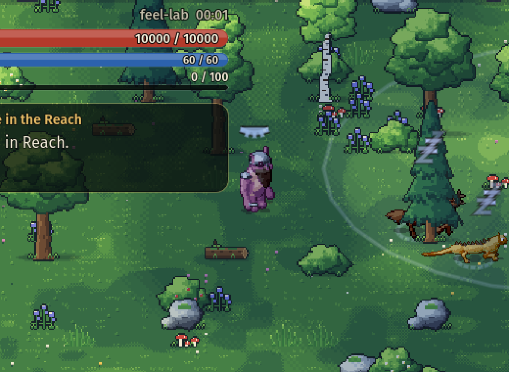
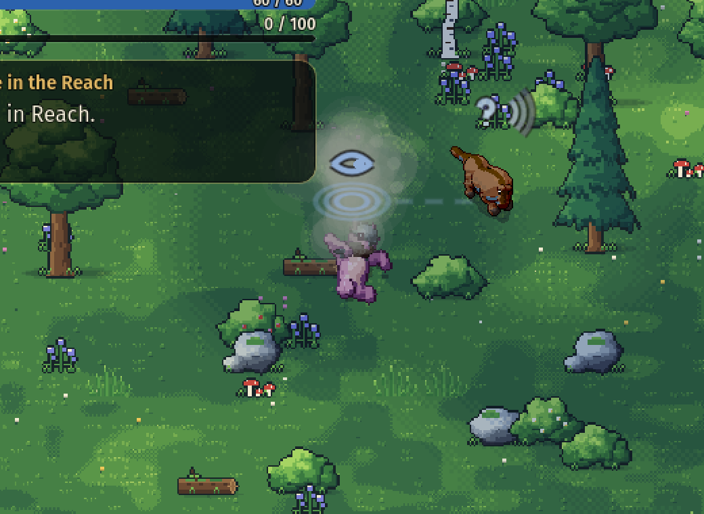
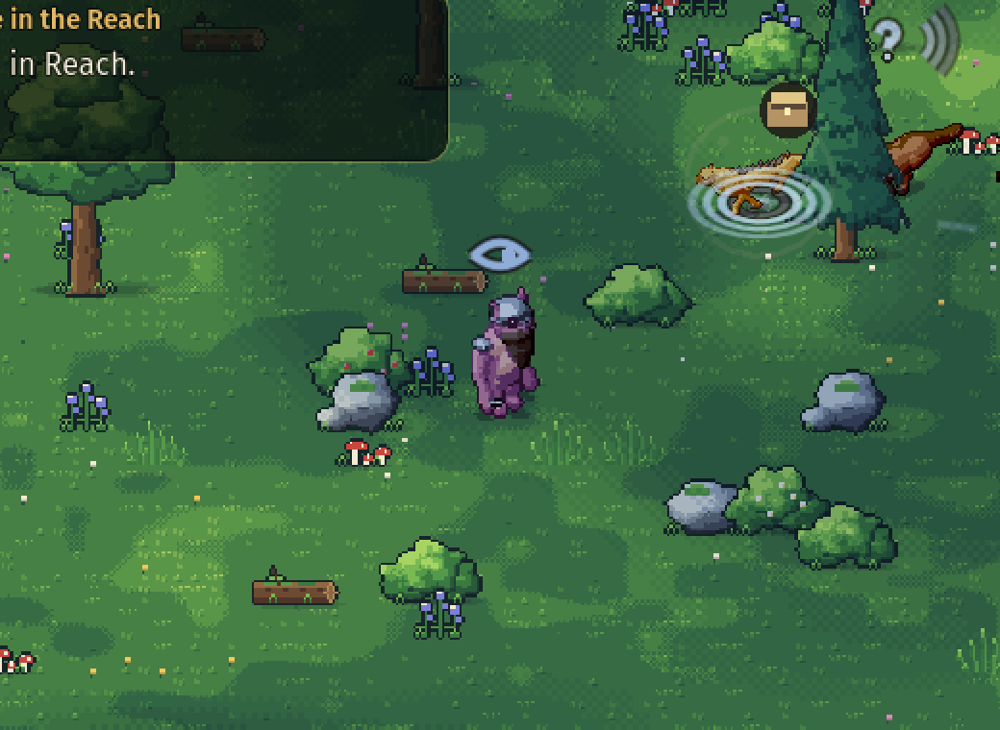
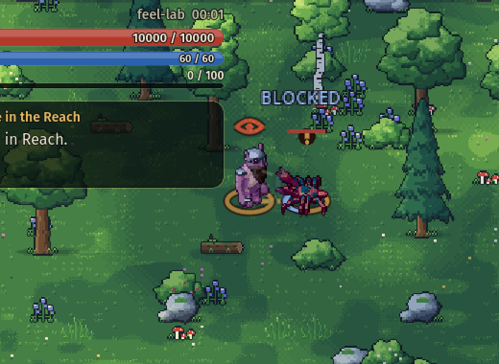
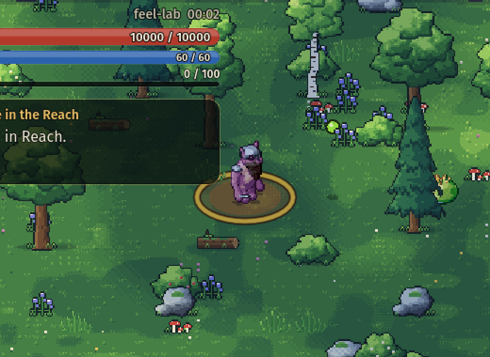
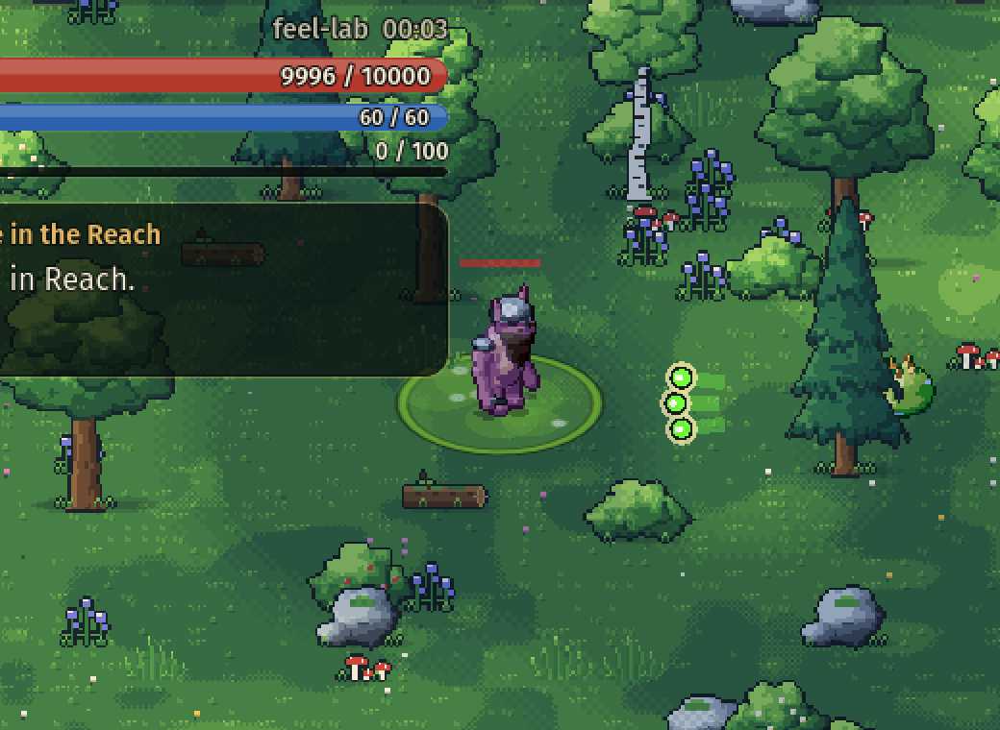
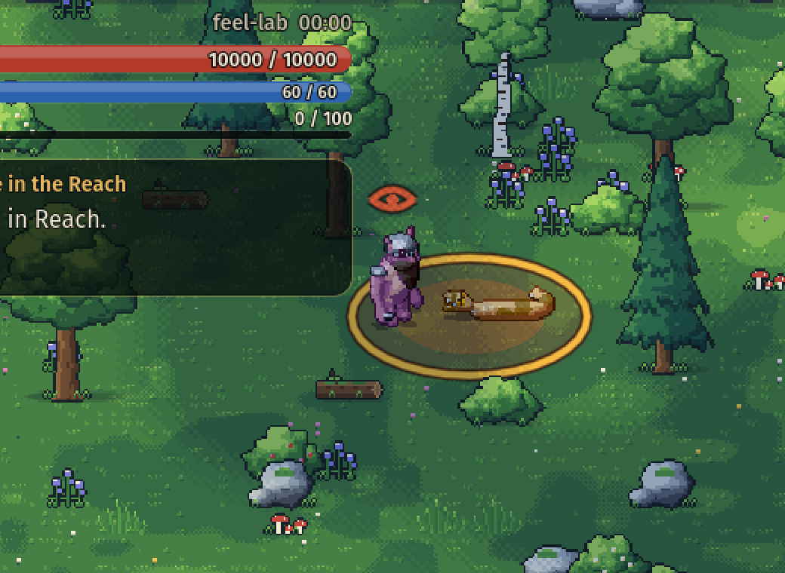
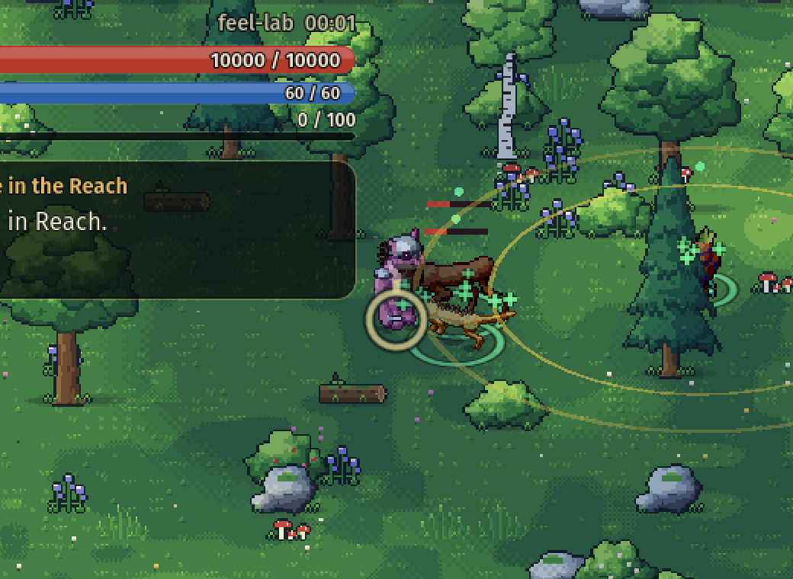
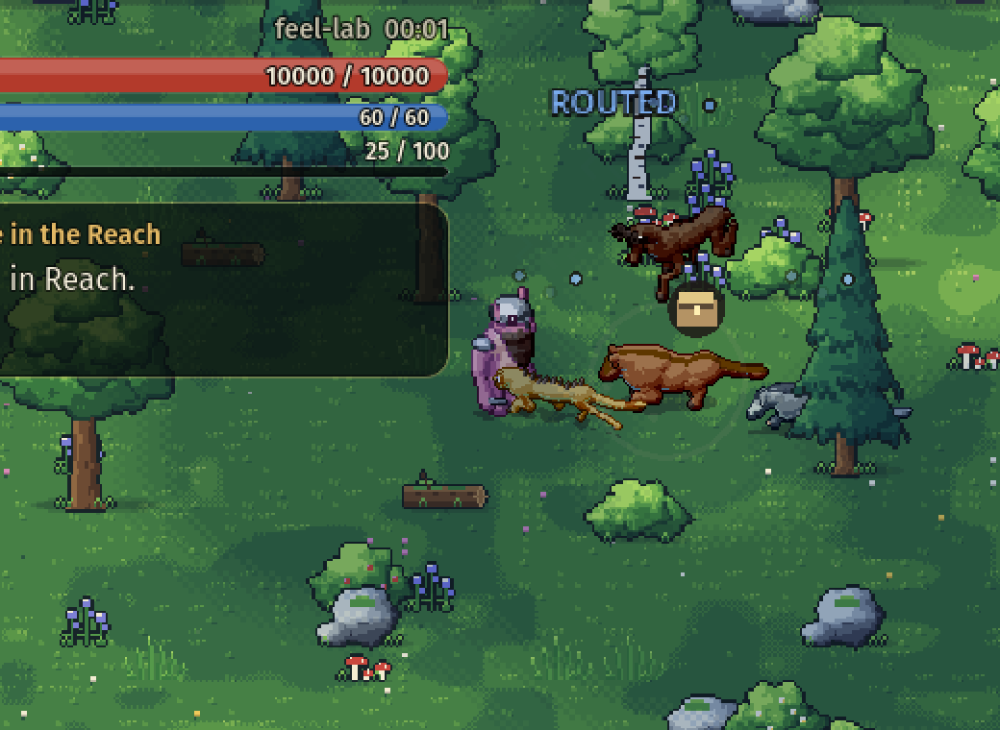

# Enemy behaviour and animation

How Mosslight's enemies notice, hunt, fight and fall, how that is shown, and how to author and check it. Everything here is driven by saved actor state and the world clock: a reloaded save or a replayed input sequence produces the same decisions and the same poses.

| Suspicion | The alarm | A pack flanking |
| --- | --- | --- |
|  |  |  |

| Pounce landing zone | Charge lane | Guard broken |
| --- | --- | --- |
|  |  |  |

| Asleep at the post | Heard a roll | Found a body |
| --- | --- | --- |
|  |  |  |

| A blow turned on a shell | A lobbed glob in flight | The pool it leaves |
| --- | --- | --- |
|  |  |  |

| A lasher's coil | A mender's bloom | The alpha falls |
| --- | --- | --- |
|  |  |  |

Captures are from `--enemy-preview` (software renderer, combat lab, 2× crop).

## Awareness

Every non-player actor carries an `Awareness` (saved in `ActorState`):

| State | What the actor is doing | Shown as |
| --- | --- | --- |
| `Unaware` | Its routine: wandering near its post, resting, lying in ambush. | Relaxed. Nothing overhead. |
| `Suspicious` | Glimpsed something. Stops, turns to look; walks closer if the suspicion grows. | Wary posture, an amber **?** whose ring fills with the detection meter. |
| `Alerted` | Recognised an intruder. A short beat before acting; the one who sees it cries out. | A bark (the caller) or a startled hop (the called), a red **!**. |
| `Engaged` | Fighting or chasing. | Combat stance, facing the quarry even while circling or backing away. |
| `Searching` | Lost the quarry. Goes to where it was last seen and probes around it. | Head sweeping and sniffing, a pale **?**. |
| `Returning` | Gave up or was drawn too far. Walks home, mending as it goes. | Three fading dots, then relaxed. |

**Senses.** An actor sees a hostile inside its view cone (`SightHalfAngle` either side of its facing, out to `SightDistance`) with a clear sightline, and hears anything within `HearingDistance` from any side. Recognition is near instant up close and takes about a second at the edge of sight. Facing is simulation state (`FacingX/Y`): it follows movement, turns to a quarry in a fight, and glances around between legs of an idle wander — which is what makes an approach from behind possible, and timing it worthwhile.

**Sound.** Hearing depends on how much noise the quarry makes. Moving faster than `CombatTuning.SneakPace` (60%) of full pace, or acting at all, is loud and heard at the full `HearingDistance`; creeping is heard only inside `QuietHearing` (45%) of it. The keyboard's Shift halves walking pace; a touch stick pushed about halfway does the same.

**Noise** is an event in the world, separate from sight: blows landing (`FightNoise`, 170), a sword swing (55), a roll (70), a charge crashing into a wall (230), a lever pulled or a door unlocked (180). Calm actors hostile to whoever caused it, within that radius (×0.6 through walls), go and search where it was. They learn the place, not the culprit, so a noise is never an alarm. Fighters, ambushers lying in wait, and actors in a moment of leash resolve ignore it.

**Sleepers.** An actor with `Sleeper` set dozes at its post whenever nothing has disturbed it lately. Asleep, it sees nothing, hears at half range and only notices a careless step or a body brushing against it. Woken, it takes `WakeSeconds` (0.9) to get up. A blow on a sleeper deals ×2 (`SleepingMultiplier`). A call or a noise wakes it too. Two of the ruin's ten are sleepers (`spawns.json: asleep`) and so is the last Reach prowler.

**Evidence.** An awake, calm actor that sees a slain member of its own faction (one a hostile left there) searches around the body and warns those in `CallRadius`, who search too. Each body is found once; one an actor watched fall is never "found" later.

**Wariness.** Any search or hunt leaves an actor `wary` for `WarySeconds` (25): it stays awake, and recognition takes `WaryNotice` (60%) of the usual time.

**Ambush.** A direct player hit on an `Unaware` or `Suspicious` foe deals ×1.5 damage (`CombatTuning.AmbushMultiplier`), ×2 on a sleeper. The victim engages at once.

**Calling for help.** The actor that sights an intruder calls allies of its faction within `CallRadius` (in line of sight, or very close). They are alerted to the same quarry after a short staggered delay. Called allies do not call again, so an alarm does not run through a whole dungeon. Being struck also raises a call.

**Losing the quarry.** A pursuer keeps chasing on memory for `MemorySeconds` after losing sight (and reads the quarry's true position for the first second, so it follows around a corner). Then it searches the area for `SearchSeconds`, then returns. An actor drawn further than `LeashDistance` from its post, by a quarry that is also beyond it, breaks off. Actors far from the player simply forget.

## Tactics

`CombatBrain.Select` is a pure function of world state. It chooses an intention; SPELL remains the only thing that checks eligibility, charges costs and applies effects.

- **Turn-taking.** At most `CombatTuning.MeleeTokens` (2) melee enemies press one target at once. Priority goes to anyone already swinging, then the nearest who has not just attacked, so a pack rotates its attackers. The rest take `flank` slots on the far side of the target and walk the ring to reach them.
- **Strafing.** Enemies that have nothing to do this moment circle the target in bouts (`Reposition` is the fraction of time spent moving), keeping their facing on it.
- **Skirmishers** dart in when their attack is ready and withdraw to `PreferredDistance` between attacks.
- **Support** keeps its distance, rallies fighting allies and pushes away anything that crowds it.
- **Nerve.** Below `RetreatThreshold` health an enemy breaks for a few seconds at a time, running toward the nearest ally if there is one.
- **Morale.** An engaged enemy that sees an ally fall holds its nerve with chance `Morale` (1 never breaks); otherwise it runs for `RoutSeconds` (3.5). When the fallen ally is a `Leader`, every follower that sees it runs for `LeaderRoutSeconds` (5.5). Routed enemies run to `RoutDistance` (170) and then watch, cowering (`cower`), until their nerve returns. A runner that reaches unaware allies brings them into the fight, once every ten seconds.
- **Slow turners** (`TurnDegrees`) come round at that rate and only start an attack on something within `TurnAttackHalfAngle` (55°) of dead ahead; until then they `turn`.
- **Evasion.** When the player commits to a sword swing at them, engaged enemies with `EvadeChance` may hop clear (a short protected dodge on its own cooldown). Unaware enemies never dodge.

### Attack kinds

| Field | Effect |
| --- | --- |
| `Lunge { Distance, Start, End }` | Committed movement along the attack direction during the action (pounce, sting dart). The cone telegraph is drawn at the landing spot. |
| `Charge { Distance, Speed, Reach, CrashStagger }` with `Geometry.Shape: "line"` | After the windup the actor runs down its committed lane and hits the first hostile it touches, once. Meeting terrain first ends the charge in a daze of `CrashStagger` seconds. |
| `MinRange` | The tactician will not start the ability closer than this. |
| `Knockback` | Ground pixels a direct hit pushes its victim (default 15). |
| `Projectile.Count`, `SpreadDegrees` | A volley fanned evenly across the spread. |
| `Self` + `Status` + `AllyRadius` | Grants the status to the caster and to allies in the radius. A rally whose status heals is used when someone in reach, itself included, is below 80% health. |
| `Blast { Radius, Delay }` with `Geometry.Shape: "blast"` | Lobbed at the ground where the target stood when the windup began. After the windup it is in the air for `Delay` seconds, warned all the while, then hits everyone hostile inside `Radius`. Interrupted in its windup, nothing is thrown; if the thrower dies in flight it still lands, harmlessly, and still pools. |
| `Pool { Duration, Interval, Damage, Status }` | What a blast leaves: periodic damage and/or a status to hostiles standing in it, never interrupting. |
| `Geometry.Shape: "burst"` | All round the body out to `Geometry.Range`. |

Lobbed attacks in flight and pools are `HazardState`s in the world and in saves (`SaveData.Hazards`).

**Shell.** A profile with `ShieldArc` turns direct hits arriving within that many degrees of its facing: only `ShieldFactor` of the damage gets through, nothing staggers and poise is not worn (the hit reads as *blocked*). The shell is up only once it has noticed something, and is open while it recovers from its own attack or reels. Damage over time ignores it. A shell must come with `TurnDegrees`, so it can always be got round.

**Mending.** A status with `Heal` restores that much health per stack each interval. It cannot also do damage.

**Guard.** A profile with `Poise` absorbs that much direct damage before a hit staggers. Hits that leave some poise hurt but do not interrupt (the hit reads as *guarded*); the hit that spends it breaks the guard for a longer stagger (`CombatTuning.GuardBreakStagger`) and refills it. Poise recovers after `PoiseRecoverySeconds` without being hit. Damage over time never interrupts a guarded foe, and never interrupts the player.

### Inhabitants

| Profile | Body | Role |
| --- | --- | --- |
| `mire` | quadruped | Reach prowlers: a loose pack with the senses above and a bite. Kept clear of the starting settlement. |
| `prowler` | quadruped | Pack hunter. Pounces from leaping distance, bites up close, takes turns, sometimes hops out of a swing. |
| `brute` | reptile | Guarded. Charges down a lane from range, sweeps up close, bellows itself into a rage when badly hurt. |
| `spitter` | amorphous | Keeps its range, strafes between shots, fans a three-shot volley at mid range. |
| `stalker` | arthropod | Lies folded and unmarked until something comes close, then stings (venom) and skirmishes. |
| `howler` | winged | Support. Its screech sends nearby fighting allies into a frenzy; its wings throw a crowding intruder back. |
| `alpha` | quadruped | The pack's `Leader`: pounces and bites, carries a light guard, howls its pack into a frenzy. Never breaks; its fall breaks every follower that sees it. Prowlers are placed in its hall. |
| `shellback` | arthropod | A hard front (`ShieldArc` 75) on a slow body (110°/s). Its pincer snares (−32 speed). Get round it, or strike as it recovers. |
| `lasher` | serpent | Lunges with venomous fangs from a few lengths, coils and lashes all round itself up close, and slips aside from swings. |
| `mender` | plantfolk | Support. Keeps its distance, snares with a root lash, and blooms to mend the wounded (`regrowth`), itself included. Its nerve is the weakest. |

`spitter` also lobs an acid `glob` that pools for four seconds. `prowler`, `mire`, `spitter` and `howler` have `Morale` below 1; `brute`, `stalker`, `shellback` and `lasher` hold. Every profile's body (family, speed, health) is read from `spawns.json` by `EnemyRoster`, which the lab, previews and checks share.

The ruin's ten inhabitants follow the `roster` in `spawns.json`; slots listed in `asleep` are found dozing.

## Animation

All motion is procedural (the vendored creature motor), so each layer works for every body plan.

- **Stances** (`StanceKind`): relaxed, wary, combat, search, flee, enraged, charge, guard (hunkered behind a raised shell). Persistent postures blended over locomotion. `CharacterView.ReadStance` derives the stance from saved actor state alone.
- **Reactions** (`ReactionKind`): startle (also on waking or finding a body), reel (guard broken), crash (charge into a wall), block (a blow turned on a shell), cower (nerve broken).
- **Sleep** uses the rest pose, like a dormant ambusher. Short one-shots layered over whatever the body is doing.
- **Attacks**: `Pounce` leaves the ground just before the strike and lands on it; `Charge` paws and sinks back, then hands over to a head-down run on real locomotion; the existing bite, slam, sting, wing buffet, spray and roar styles are used by content.
- **Evasive hop** for bodies that cannot roll.
- **Death** is a staged collapse chosen by body plan — four-legged bodies stagger and go over on their side, upright bodies drop to their knees and pitch forward, soft bodies shudder and spread, fliers flail and drop, swimmers turn belly-up — ending in a held pose. It replaces the old sleeping pose. Corpses restored from a save are already down.
- **Marks** (`ActorOverlay`): the awareness glyphs above, plus drifting "z"s while asleep, a small open eye while wary, sound arcs beside the search mark when a noise drew it, drops flying off the head while routed, a crest over a leader; a guard bar for guarded foes in a fight, circling stars during a long stagger, a ground ring for rage (red), frenzy (amber) and mending (green), one coloured pip per status, and a ground arc on a shell's front (bright while raised, broken while open).
- **Senses** (`SenseView`, under the warnings): for each nearby enemy that has not recognised the player, a faint view cone stopped by walls (amber when suspicious or wary) and a dashed ring at the distance it would hear the player *moving as they are now*. It shrinks when the player creeps and when the listener sleeps, and turns amber when the player is nearly inside it. A hunter that has lost its quarry shows a thread to the spot it is heading for.
- **The player's eye** (`StealthMark`): shut while nearby enemies have noticed nothing, opening with the strongest suspicion, pale and scanning while something searches, red for a moment when recognised. Lurking ambushers do not register.
- **Telegraphs**: the charge lane with chevrons (still shown while it is being run), the leap's landing zone, a burst's ring round the body, and a lobbed attack's landing ring, filling through the windup *and* the flight, with the glob itself arcing over its shadow. Pools are drawn as bubbling puddles that thin as they dry.
- **Effects and sound**: alarm ticks, guarded spark, guard-break shards, crash dust, rally rings, a block flash, a splash, noise ripples, rising green crosses for mending, a shiver for a broken nerve; call-outs AMBUSH, BLOCKED, GUARD BROKEN and ROUTED; cues `alert`, `roar`, `charge`, `guard`, `guard_break`, `crash`, `block`, `splash`, `heard`, `wake`, `whimper`, `mend`, `lob`. Dust rises under charges, leaps and hops.

Contact sheets from `--enemy-animation-sheets` (one row per clip, twelve frames each): [prowler](enemy-screenshots/sheet-prowler.png), [brute](enemy-screenshots/sheet-brute.png), [stalker](enemy-screenshots/sheet-stalker.png), [howler](enemy-screenshots/sheet-howler.png), [shellback](enemy-screenshots/sheet-shellback.png), [lasher](enemy-screenshots/sheet-lasher.png), [mender](enemy-screenshots/sheet-mender.png). In game: [charge run](enemy-screenshots/charge-run.png), [enraged](enemy-screenshots/enraged.png), [stalker sting](enemy-screenshots/stalker-sting.png), [howler rally](enemy-screenshots/howler-rally.png), [falling](enemy-screenshots/death-falling.png), [fallen](enemy-screenshots/death-settled.png).

Marks and pulses respect the reduced-motion preference. Presentation only observes: nothing above moves an actor, deals damage or changes timing.

## Authoring

Combat profile fields added here (all optional; defaults give sensible senses to any profile):

`SightDistance` (0 = `PursuitDistance`), `SightHalfAngle`, `HearingDistance`, `NoticeSeconds`, `CallRadius`, `MemorySeconds`, `SearchSeconds`, `LeashDistance` (≥ `PursuitDistance`), `RoamDistance`, `Ambusher`, `Poise`, `EvadeChance` / `EvadeDistance` / `EvadeCooldown`, `EnrageThreshold` + `EnrageAbility`, `RallyAbility`, `ShieldArc` (needs `TurnDegrees`) / `ShieldFactor`, `TurnDegrees`, `Leader` (needs `Morale` 1), `Morale`. `Behaviour` accepts `melee`, `ranged`, `skirmish`, `support`.

Ability fields: `Blast` (with a `"blast"` geometry and telegraph of the same radius), `Pool` (only on a blast), and the `"burst"` shape and telegraph. Status field: `Heal`. Spawn field: `asleep` (roster slots). Actor field: `Sleeper`.

`CombatProfileDef.Loadout()` is the list of abilities an actor of that kind carries (its priorities plus its own self abilities). Statuses accept extra per-stack `Modifiers` beside `ModifierStat`. `Content.Validate` rejects contradictory values; `ContentAudit` checks the roster.

Saves stay schema 1: every new `ActorState` field is optional and defaults to a calm, unguarded, wakeful actor, and a save without `Hazards` has clear ground, so older saves load with everyone at ease. Actors without a profile use `CombatProfileDef.Legacy` senses.

## Tools and checks

```sh
# Contact sheets of every posture, reaction, attack and death for each body plan. No display needed.
godot --headless --path . -- --enemy-animation-sheets            # build/enemy-animation/*.png
godot --headless --path . -- --enemy-animation-sheets=prowler,brute

# Staged in-game captures of each behaviour beat in the production renderer.
xvfb-run -a godot --path . --audio-driver Dummy -- --visual-check --enemy-preview   # build/enemy-preview/*.png

# A scripted duelist fights every combat-lab encounter (three seeds, normal health) and tabulates
# wins, time, damage taken and what hurt most. For comparing encounters, not judging feel.
godot --headless --path . -- --enemy-encounter-report            # build/enemy-encounters.json
godot --headless --path . -- --enemy-encounter-report=alpha,depths

# Just the suites you are working on, reporting every failure rather than the first.
python3 tools/verify.py --headless --test-only=EnemyBehaviorChecks,EnemyAnimationChecks --test-keep-going
```

- `EnemyBehaviorChecks` drives the production world step on an open arena: senses (including quiet and careless steps), noise and its walls, sleepers, finding bodies and wariness, morale and the leader's fall, the shell and slow turning, lobbed blasts and pools, bursts, mending, the pack call, searching and returning, the leash, turn-taking and flanking, pounce, charge and crash, guard and rage, evasion, the stalker, the howler, volleys, roaming, save/load mid-fight (including a glob in flight), an older save without the new fields, and content validation.
- `EnemyAnimationChecks` compares poses for all ten preview body plans (stances, reactions, death, every authored attack style, the hop) and checks the production view's reading of state into stance, facing, marks, sense cones and rings, the player's eye, telegraphs, effects, call-outs and sound.
- The gameplay replay records thirteen `behaviour-*` scenes (notice, pack, pounce, charge, guard, ambush, rally, sneak, noise, shell, glob, rout, mend) with their own assertions and trace rows.
- The developer combat lab accepts `stalker`, `howler`, `pack`, `ruin`, `alpha`, `shellback`, `lasher`, `mender`, `sleepers` and `depths` encounters as well as the earlier ones.

Automated checks establish that behaviour and poses are produced and consistent. They do not establish that a fight feels fair or that an animation reads well on a phone; the sheets and captures exist so a person can look.
