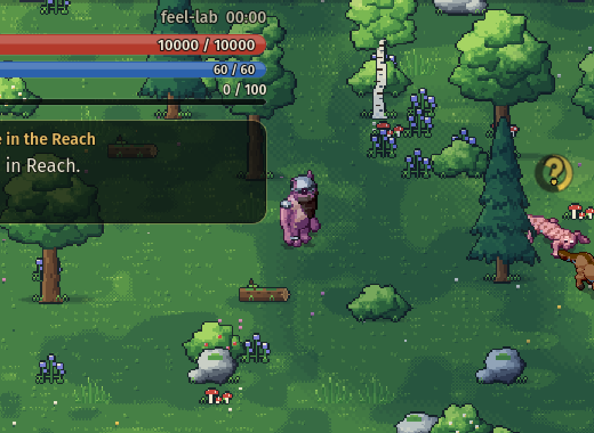
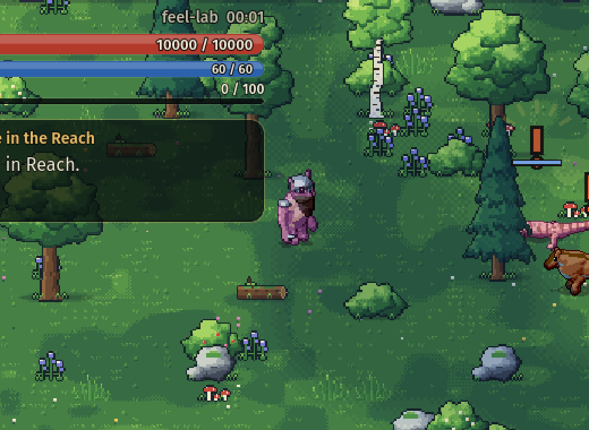
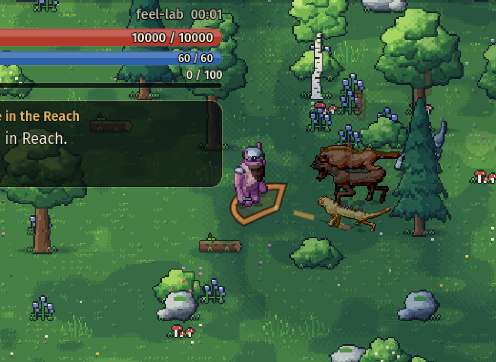
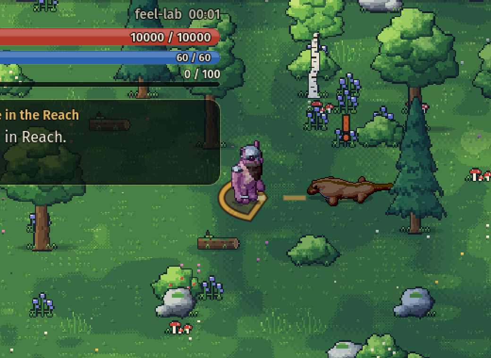
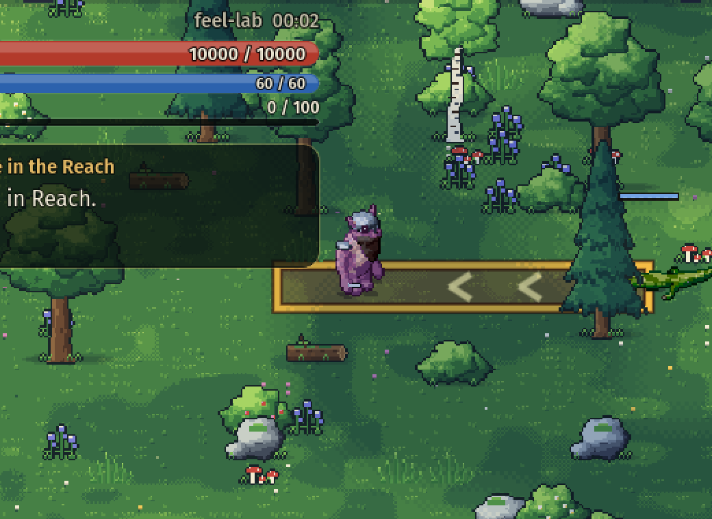
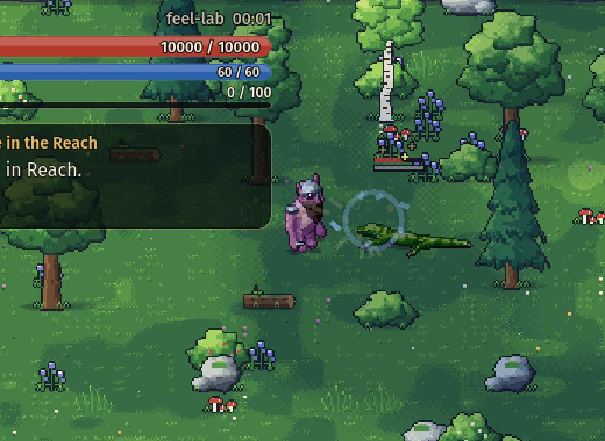

# Enemy behaviour and animation

How Mosslight's enemies notice, hunt, fight and fall, how that is shown, and how to author and check it. Everything here is driven by saved actor state and the world clock: a reloaded save or a replayed input sequence produces the same decisions and the same poses.

| Suspicion | The alarm | A pack flanking |
| --- | --- | --- |
|  |  |  |

| Pounce landing zone | Charge lane | Guard broken |
| --- | --- | --- |
|  |  |  |

Captures are from `--enemy-preview` (software renderer, combat lab, 2× crop).

## Awareness

Every non-player actor carries an `Awareness` (saved in `ActorState`):

| State | What the actor is doing | Shown as |
| --- | --- | --- |
| `Unaware` | Its routine: wandering near its post, resting, lying in ambush. | Relaxed. Nothing overhead. |
| `Suspicious` | Glimpsed something. Stops, turns to look; walks closer if the suspicion grows. | Wary posture, an amber **?** whose ring fills with the detection meter. |
| `Alerted` | Recognised an intruder. A short beat before acting; the one who sees it cries out. | A bark (the caller) or a startled hop (the called), a red **!**. |
| `Engaged` | Fighting or chasing. | Combat stance, facing the quarry even while circling or backing away. |
| `Searching` | Lost the quarry. Goes to where it was last seen and probes around it. | Head sweeping and sniffing, a pale **?**. |
| `Returning` | Gave up or was drawn too far. Walks home, mending as it goes. | Three fading dots, then relaxed. |

**Senses.** An actor sees a hostile inside its view cone (`SightHalfAngle` either side of its facing, out to `SightDistance`) with a clear sightline, and hears anything within `HearingDistance` from any side. Recognition is near instant up close and takes about a second at the edge of sight. Facing is simulation state (`FacingX/Y`): it follows movement, turns to a quarry in a fight, and glances around between legs of an idle wander — which is what makes an approach from behind possible, and timing it worthwhile.

**Ambush.** A direct player hit on an `Unaware` or `Suspicious` foe deals ×1.5 damage (`CombatTuning.AmbushMultiplier`). The victim engages at once.

**Calling for help.** The actor that sights an intruder calls allies of its faction within `CallRadius` (in line of sight, or very close). They are alerted to the same quarry after a short staggered delay. Called allies do not call again, so an alarm does not run through a whole dungeon. Being struck also raises a call.

**Losing the quarry.** A pursuer keeps chasing on memory for `MemorySeconds` after losing sight (and reads the quarry's true position for the first second, so it follows around a corner). Then it searches the area for `SearchSeconds`, then returns. An actor drawn further than `LeashDistance` from its post, by a quarry that is also beyond it, breaks off. Actors far from the player simply forget.

## Tactics

`CombatBrain.Select` is a pure function of world state. It chooses an intention; SPELL remains the only thing that checks eligibility, charges costs and applies effects.

- **Turn-taking.** At most `CombatTuning.MeleeTokens` (2) melee enemies press one target at once. Priority goes to anyone already swinging, then the nearest who has not just attacked, so a pack rotates its attackers. The rest take `flank` slots on the far side of the target and walk the ring to reach them.
- **Strafing.** Enemies that have nothing to do this moment circle the target in bouts (`Reposition` is the fraction of time spent moving), keeping their facing on it.
- **Skirmishers** dart in when their attack is ready and withdraw to `PreferredDistance` between attacks.
- **Support** keeps its distance, rallies fighting allies and pushes away anything that crowds it.
- **Nerve.** Below `RetreatThreshold` health an enemy breaks for a few seconds at a time, running toward the nearest ally if there is one.
- **Evasion.** When the player commits to a sword swing at them, engaged enemies with `EvadeChance` may hop clear (a short protected dodge on its own cooldown). Unaware enemies never dodge.

### Attack kinds

| Field | Effect |
| --- | --- |
| `Lunge { Distance, Start, End }` | Committed movement along the attack direction during the action (pounce, sting dart). The cone telegraph is drawn at the landing spot. |
| `Charge { Distance, Speed, Reach, CrashStagger }` with `Geometry.Shape: "line"` | After the windup the actor runs down its committed lane and hits the first hostile it touches, once. Meeting terrain first ends the charge in a daze of `CrashStagger` seconds. |
| `MinRange` | The tactician will not start the ability closer than this. |
| `Knockback` | Ground pixels a direct hit pushes its victim (default 15). |
| `Projectile.Count`, `SpreadDegrees` | A volley fanned evenly across the spread. |
| `Self` + `Status` + `AllyRadius` | Grants the status to the caster and to allies in the radius. |

**Guard.** A profile with `Poise` absorbs that much direct damage before a hit staggers. Hits that leave some poise hurt but do not interrupt (the hit reads as *guarded*); the hit that spends it breaks the guard for a longer stagger (`CombatTuning.GuardBreakStagger`) and refills it. Poise recovers after `PoiseRecoverySeconds` without being hit. Damage over time never interrupts a guarded foe, and never interrupts the player.

### Inhabitants

| Profile | Body | Role |
| --- | --- | --- |
| `mire` | quadruped | Reach prowlers: a loose pack with the senses above and a bite. Kept clear of the starting settlement. |
| `prowler` | quadruped | Pack hunter. Pounces from leaping distance, bites up close, takes turns, sometimes hops out of a swing. |
| `brute` | reptile | Guarded. Charges down a lane from range, sweeps up close, bellows itself into a rage when badly hurt. |
| `spitter` | amorphous | Keeps its range, strafes between shots, fans a three-shot volley at mid range. |
| `stalker` | arthropod | Lies folded and unmarked until something comes close, then stings (venom) and skirmishes. |
| `howler` | winged | Support. Its screech sends nearby fighting allies into a frenzy; its wings throw a crowding intruder back. |

The ruin's eight inhabitants follow the `roster` in `spawns.json`.

## Animation

All motion is procedural (the vendored creature motor), so each layer works for every body plan.

- **Stances** (`StanceKind`): relaxed, wary, combat, search, flee, enraged, charge. Persistent postures blended over locomotion. `CharacterView.ReadStance` derives the stance from saved actor state alone.
- **Reactions** (`ReactionKind`): startle, reel (guard broken), crash (charge into a wall). Short one-shots layered over whatever the body is doing.
- **Attacks**: `Pounce` leaves the ground just before the strike and lands on it; `Charge` paws and sinks back, then hands over to a head-down run on real locomotion; the existing bite, slam, sting, wing buffet, spray and roar styles are used by content.
- **Evasive hop** for bodies that cannot roll.
- **Death** is a staged collapse chosen by body plan — four-legged bodies stagger and go over on their side, upright bodies drop to their knees and pitch forward, soft bodies shudder and spread, fliers flail and drop, swimmers turn belly-up — ending in a held pose. It replaces the old sleeping pose. Corpses restored from a save are already down.
- **Marks** (`ActorOverlay`): the awareness glyphs above, a guard bar for guarded foes in a fight, circling stars during a long stagger, a ground ring for rage (red) and frenzy (amber), one coloured pip per status.
- **Telegraphs**: the charge lane with chevrons (still shown while it is being run), and the leap's landing zone.
- **Effects and sound**: alarm ticks, guarded spark, guard-break shards, crash dust, rally rings; cues `alert`, `roar`, `charge`, `guard`, `guard_break`, `crash`. Dust rises under charges, leaps and hops.

Contact sheets from `--enemy-animation-sheets` (one row per clip, twelve frames each): [prowler](enemy-screenshots/sheet-prowler.png), [brute](enemy-screenshots/sheet-brute.png), [stalker](enemy-screenshots/sheet-stalker.png), [howler](enemy-screenshots/sheet-howler.png). In game: [charge run](enemy-screenshots/charge-run.png), [enraged](enemy-screenshots/enraged.png), [stalker sting](enemy-screenshots/stalker-sting.png), [howler rally](enemy-screenshots/howler-rally.png), [falling](enemy-screenshots/death-falling.png), [fallen](enemy-screenshots/death-settled.png).

Marks and pulses respect the reduced-motion preference. Presentation only observes: nothing above moves an actor, deals damage or changes timing.

## Authoring

Combat profile fields added here (all optional; defaults give sensible senses to any profile):

`SightDistance` (0 = `PursuitDistance`), `SightHalfAngle`, `HearingDistance`, `NoticeSeconds`, `CallRadius`, `MemorySeconds`, `SearchSeconds`, `LeashDistance` (≥ `PursuitDistance`), `RoamDistance`, `Ambusher`, `Poise`, `EvadeChance` / `EvadeDistance` / `EvadeCooldown`, `EnrageThreshold` + `EnrageAbility`, `RallyAbility`. `Behaviour` accepts `melee`, `ranged`, `skirmish`, `support`.

`CombatProfileDef.Loadout()` is the list of abilities an actor of that kind carries (its priorities plus its own self abilities). Statuses accept extra per-stack `Modifiers` beside `ModifierStat`. `Content.Validate` rejects contradictory values; `ContentAudit` checks the roster.

Saves stay schema 1: every new `ActorState` field is optional and defaults to a calm, unguarded actor, so older saves load with everyone at ease. Actors without a profile use `CombatProfileDef.Legacy` senses.

## Tools and checks

```sh
# Contact sheets of every posture, reaction, attack and death for each body plan. No display needed.
godot --headless --path . -- --enemy-animation-sheets            # build/enemy-animation/*.png
godot --headless --path . -- --enemy-animation-sheets=prowler,brute

# Staged in-game captures of each behaviour beat in the production renderer.
xvfb-run -a godot --path . --audio-driver Dummy -- --visual-check --enemy-preview   # build/enemy-preview/*.png

# Just the suites you are working on, reporting every failure rather than the first.
python3 tools/verify.py --headless --test-only=EnemyBehaviorChecks,EnemyAnimationChecks --test-keep-going
```

- `EnemyBehaviorChecks` drives the production world step on an open arena: senses, the pack call, searching and returning, the leash, turn-taking and flanking, pounce, charge and crash, guard and rage, evasion, the stalker, the howler, volleys, roaming, save/load mid-fight, an older save without the new fields, and content validation.
- `EnemyAnimationChecks` compares poses for all eight preview body plans (stances, reactions, death, every authored attack style, the hop) and checks the production view's reading of state into stance, facing, marks, telegraphs, effects and sound.
- The gameplay replay records seven `behaviour-*` scenes (notice, pack, pounce, charge, guard, ambush, rally) with their own assertions and trace rows.
- The developer combat lab accepts `stalker`, `howler`, `pack` and `ruin` encounters as well as the earlier ones.

Automated checks establish that behaviour and poses are produced and consistent. They do not establish that a fight feels fair or that an animation reads well on a phone; the sheets and captures exist so a person can look.
