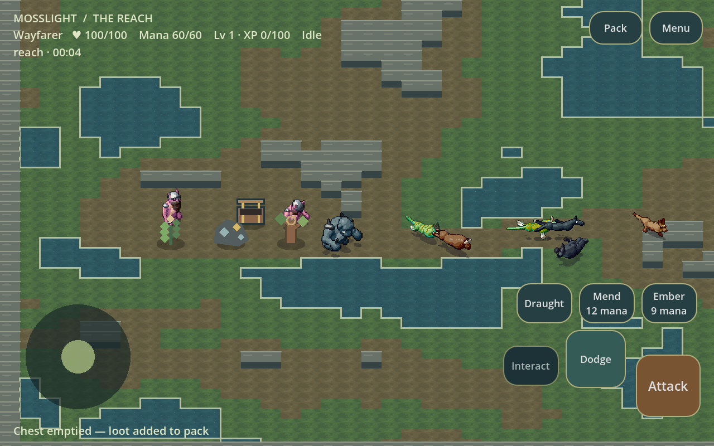
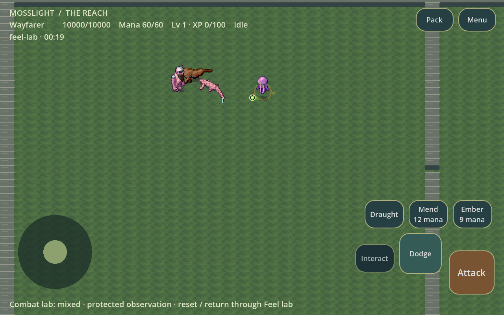
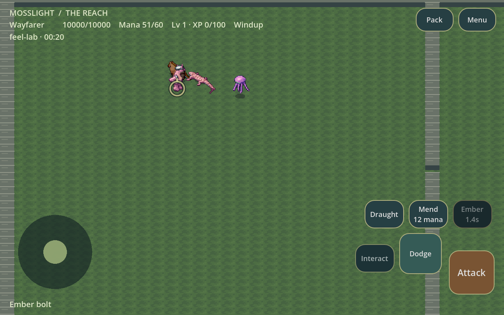

# PR #4 final verification

Part 4's executable acceptance checks passed on **`c7c4d3293f5008312e30353d0199e5df34d8582a`**. Branch: `feat/combat-feel-enemy-ai-mobile`. [PR #4](https://github.com/CigThePig/RPG-test/pull/4) is prepared for code review and remains unmerged. A subsequent documentation-only commit records these results and screenshots; the APK and all final evidence identify the tested source above.

Physical-device touch comfort, subjective combat feel, audio quality, and sustained ARM64 performance remain pending user acceptance before merge.

## Executed checks

| Check | Actual result |
|---|---|
| `dotnet build` | Exit 0; SDK 9.0.203, 58 existing nullable warnings, zero errors |
| `python3 tools/import-project.py` | Exit 0; assets imported; known editor-shutdown EditorSettings diagnostic remains |
| `python3 tools/verify.py --headless` | Exit 0; **3,739 assertions** |
| `python3 tools/verify.py --visual` | Exit 0; complete desktop rendered suite passed |
| `python3 tools/verify.py --visual --mobile` | Exit 0; complete mobile rendered suite passed, including actual resized/inset rectangles and real touch dispatch |
| `python3 tools/gameplay-verify.py --presets baseline,precise` | Exit 0 locally; final CI runs each preset separately: **45 scenarios and a deterministic repeat per preset**, both passed |
| Preserved reference | Generation, tests and production build passed |
| Android ARM64 | Export plus package, .NET payload, ABI and signature checks passed |
| Android x86_64 runtime | Install, launch, rendering, movement, menu, chest/Gloot inventory, four Attack taps, three Dodge taps, one Ember tap and real damage passed |
| Android lifecycle | **Three consecutive nonblank, same-process mixed-combat resumes** passed; PID 2702 retained, cancellation counts 2/4/6 |
| Focused review | No outstanding inline review threads at final check; ownership, geometry, save, lifecycle and presentation paths reviewed |

All final workflow jobs completed successfully. No failing executable acceptance check remains. Local test iterations exposed a buffered-input ordering mistake in the new focus test and a mana-regeneration assumption; both test setups were corrected, and their production assertions retained. Earlier SDK-205 packages were superseded and are not the delivered APK. No Android resume-to-black failure was observed in the final run; its historical intermittent risk is not declared permanently fixed.

The editor-shutdown diagnostic (`EditorSettings not instantiated … export/android/shutdown_adb_on_exit`) occurs after import and is retained in logs. It is not represented as a clean runtime diagnostic or silently removed. All runtime verification wrappers independently reject engine/script errors.

## Exact-source evidence

- [Native checks, screenshots, encounter measurements and raw performance](https://github.com/CigThePig/RPG-test/actions/runs/40858363449/artifacts/12891025574).
- [Baseline full movie, 45 scenarios, traces, contact sheets and deterministic repeat](https://github.com/CigThePig/RPG-test/actions/runs/40858363444/artifacts/12890872055).
- [Precise full movie, 45 scenarios, traces, contact sheets and deterministic repeat](https://github.com/CigThePig/RPG-test/actions/runs/40858363444/artifacts/12891525196).
- [Android recording, screenshots, input geometry, logcat and lifecycle evidence](https://github.com/CigThePig/RPG-test/actions/runs/40858363532/artifacts/12890847007).
- [Verified ARM64 development APK and build metadata](https://github.com/CigThePig/RPG-test/actions/runs/40858363532/artifacts/12889604307).

Baseline replay state digest: `a82324f2213e6e7a5b44d5f6a811b1f2f445737c3daa381607e35ef51bfe232c`.
Precise replay state digest: `d5787733260a8c70ce4e623956510d4c759939758615e9d2f2ba019786dfd111`.
Each matches its own deterministic repeat. Movie Maker timings are not runtime FPS. Final actual UI, crowd, projectile, cooldown and resumed Android frames were inspected, together with adjacent rendered replay frames.

## Mobile controls and integration

Attack is the largest lower-right control; Dodge is immediately inward/above. Ember, Mend and Draught have a separate row with mana/cooldown text. Interact remains fixed and discoverable, with a brief emphasis hold using the same merchant, feature and corpse queries as production interaction. Pack/Menu move to the upper right. Health/mana remain clear of utilities.

`RpgUi.ActionControl(id)` identifies attack/dodge/ember/mend/potion/interact/inventory/menu independently of display text. `MobileCombatControls` owns geometry and consistent normal/hover/pressed/disabled silhouettes. Physical Android safe pixels pass through the inverse viewport screen transform, including canvas_items scaling/letterboxing, then clip to logical bounds. Five geometry configurations, nonzero insets, scaled/translated transforms and four actual window sizes are checked. Compact geometry is deterministic; cooldowns cannot enlarge hitboxes.

Each action finger owns its original button until release/cancel. Release outside, crossing buttons and orphan releases do not activate. Movement has a separate owner. Modal, focus and layout changes clear pending actions and held movement synchronously. Emulated mouse events cannot double-dispatch gameplay, while real desktop mouse/menu scrolling remains functional. Tests exercise movement with Attack, Dodge, Mend, Ember and production chest interaction, disabled/cooldown rejection, Pack/Menu, cancellation and focus restoration.

World/SPELL retains timing, eligibility, geometry, damage, defenses, resources and persistence. Skelerealms retains high-level goals; CombatBrain selects bounded tactical intentions. PPC, telegraphs, effects, audio, player locator and camera only observe authoritative decisions. Player slash/aim/lunge and roll/dust/immunity values are unchanged. Empty-air sword swings retain only their blade trail/whoosh; confirmed damage and projectile collisions retain separate feedback.

### Actual rendered frames

## Encounter audit and final values

| Archetype | Health / speed | Main windup / recovery | Base damage / cooldown |
|---|---|---|---|
| Prowler | 65 / 88 | Bite 0.30 / 0.40 s | 9 / 1.10 s |
| Brute | 120 / 46 | Slam 0.80 / 0.85 s | 14 / 2.40 s |
| Spitter | 55 / 62 | Spit 0.48 / 0.50 s | 7 / 1.80 s |

Spit remains a 135-unit/s straight projectile; Brute keeps its 52-unit, ±55° committed cone. Actual damage includes existing stats/mitigation. Authored production numbers and eight deterministic dungeon spawns remain unchanged after the audit. Lab enemies now use their intended 65/120/55 health instead of generic 100; normal-health player fixtures are separate from protected observation.

Twenty-one normal-health observation fixtures cover seven compositions and seeds 1/42/1337, with exact persistence restoration afterward. Their 12-second stationary policy records attacks/hits/misses/avoidance, damage, deaths, projectile release/collision, nearest-distance averages and intention ticks. Seed 42 stationary exposure recorded 8 Prowler hits/112 damage, 6 Brute hits/104 damage and 5 Spit hits/65 damage; mixed groups killed the undefended player. These measurements demonstrate pressure, not enjoyable difficulty or a desired win rate. Existing active-defense replays separately verify committed cones, dodges, trajectories and interruption.

The reversible lab now offers each archetype, two melee, three/four mixed, controlled projectiles and eight enemies, in normal/protected forms. Reset by selecting a fixture again; return restores the original world. Temporary actors never enter normal progression saves. Dungeon connectivity, stable IDs, key/lock progression and existing saves are preserved.

Spit gains a pale rim for contrast, without more particles. A small ground locator appears only with two nearby hostile bodies, preserving player location during overlap. Eight-enemy stress still bunches bodies; the cue does not pretend to solve crowd geometry. No hard actor collision, squad attack tokens or synchronized turns were introduced.

## Performance and limitations

[Complete final performance report](PR4_PART4_PERFORMANCE.md) records frame p50/p95/p99, simulation/AI/avoidance/projectile timings, PPC counts, allocation and managed-heap samples. Final mobile eight-enemy p95 was **30.34 ms**, with AI p95 **1.332 ms**; projectile-heavy collision p95 was **0.057 ms**. These short hosted llvmpipe results do not certify smooth 60 FPS, sustained ARM64 speed, thermals or long-session memory behaviour on the S25.

Actual Android frames show the world, controls, active cooldowns, archetypes, Spit and resumed combat. Protected screenshots are identified by their 10,000 health; they are not balance evidence for ordinary difficulty. Audio resources/pooling were tested using a dummy driver; subjective listening remains pending. The Android smoke recording covers normal controls/combat, while mixed/lifecycle Android evidence includes actual screenshots; separate Godot tactical movies provide continuous mixed/projectile footage.

## APK and phone acceptance

APK: `Mosslight-android-arm64-debug-c7c4d3293f50.apk`, 104,367,959 bytes.
SHA-256: `5d1c1376d2e236609b89371d5f4321cd386569d96ae7f170d378516422bff700`.
Metadata confirms SDK **9.0.203**. `global.json` disables SDK patch roll-forward so runner-preinstalled 9.0.205 cannot silently replace it. The Godot host's separate runtime policy remains unchanged.

Install the ARM64 file, not the x86_64 emulator package. An ephemeral development signature may require uninstalling the previous dev build; uninstalling deletes private saves. Full phone-only download, capture, trace-export and acceptance instructions are in [Android playtesting](ANDROID_PLAYTESTING.md).

Before merge, use the S25 to assess thumb reach/accidental input, cutouts/gestures, individual and mixed combat feel, sword miss/hit audio, projectile contrast, crowd tracking, 15–20 minute pacing/warmth and repeated activity-specific background/resume. Test ordinary save/load and native Files trace export. Share the workflow URL, SHA, metadata, video/screenshots, ZIP and overlay statistics; no development computer is required.

Recommendation: ready for code review after the green executable checks, with physical acceptance above still required before the user's merge decision. PR #4 is not merged automatically.
