# PR #7 — Mosslight mobile UI & RPG experience: design package

This folder is the design and implementation brief for PR #7's four UX milestones. It is written for the agent who will implement them. Read this file first, then [CREATIVE_DIRECTION.md](CREATIVE_DIRECTION.md) (the vision, signature features and resolved decisions; **it overrides the part guides where they differ**), then [DESIGN_SYSTEM.md](DESIGN_SYSTEM.md), then the guide for the part you are working on.

| Part | Guide | Delivers |
|---|---|---|
| 1 | [PART1_FOUNDATION.md](PART1_FOUNDATION.md) | Tokens, theme, fonts, icons, safe-area frame, screen stack/navigation, transitions, shared components, structured UI test hooks |
| 2 | [PART2_HUD.md](PART2_HUD.md) | Vitals (health/mana/XP), action buttons v2 with cooldowns, context-sensitive Interact, quest tracker, notifications, desktop hotbar |
| 3 | [PART3_SCREENS.md](PART3_SCREENS.md) | The Adventurer's Book: Pack (bag, equipment, item details), Crafting, Trade, Hero (stats/abilities/skills), Journal (quest stages, lore), Map |
| 4 | [PART4_DIALOGUE_SETTINGS_VERIFICATION.md](PART4_DIALOGUE_SETTINGS_VERIFICATION.md) | Dialogue Manager presentation, pause/save/load, settings, accessibility, defeat flow, developer tools separation, visual regression and phone acceptance |
| ★ | [CREATIVE_DIRECTION.md](CREATIVE_DIRECTION.md) | Living title screen, generated pixel-art UI skin, minimap HUD, combat text, action-bar loadout, live creature portraits and try-on, merchant economy, Codex, quest ceremony, death recap, coach marks, gamepad |

Mockups (1280×800 logical canvas, Touch density) live in [`mockups/`](mockups/). They are the visual target; the guides hold the numbers. If a mockup and a guide disagree, **the guide wins**. Regenerate mockups with `python3 docs/ui/mockups/build_mockups.py`.

| | |
|---|---|
| 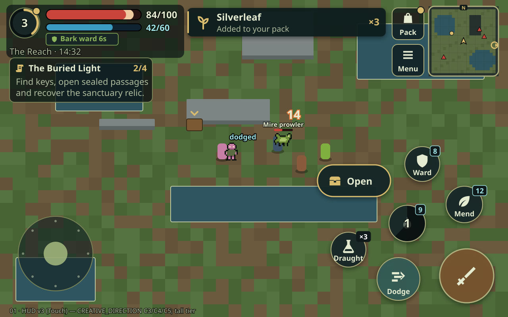 | 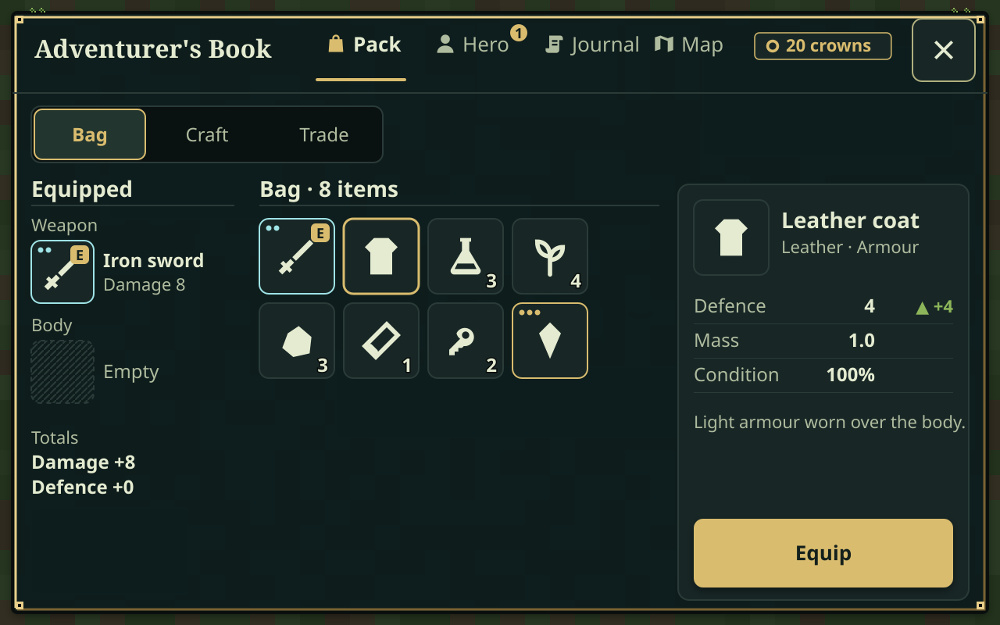 |
| 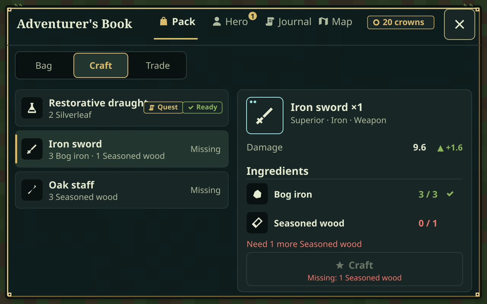 | 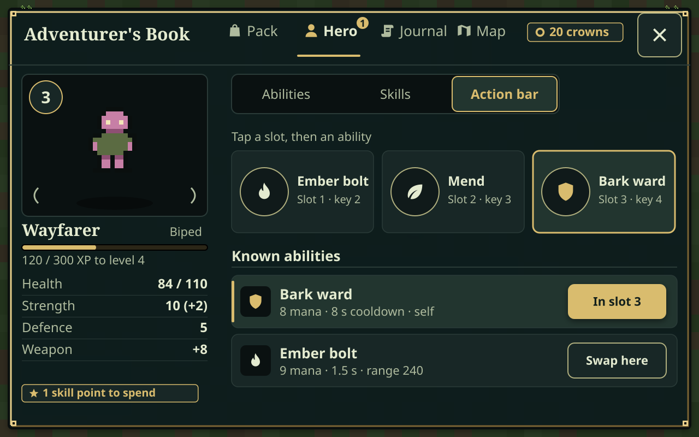 |
| 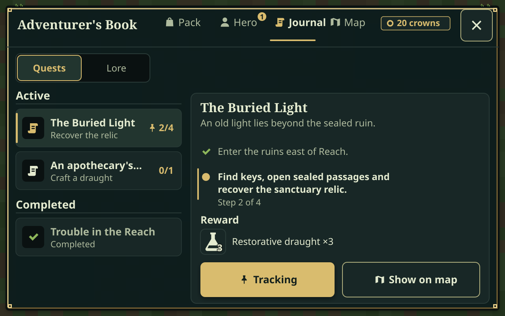 | 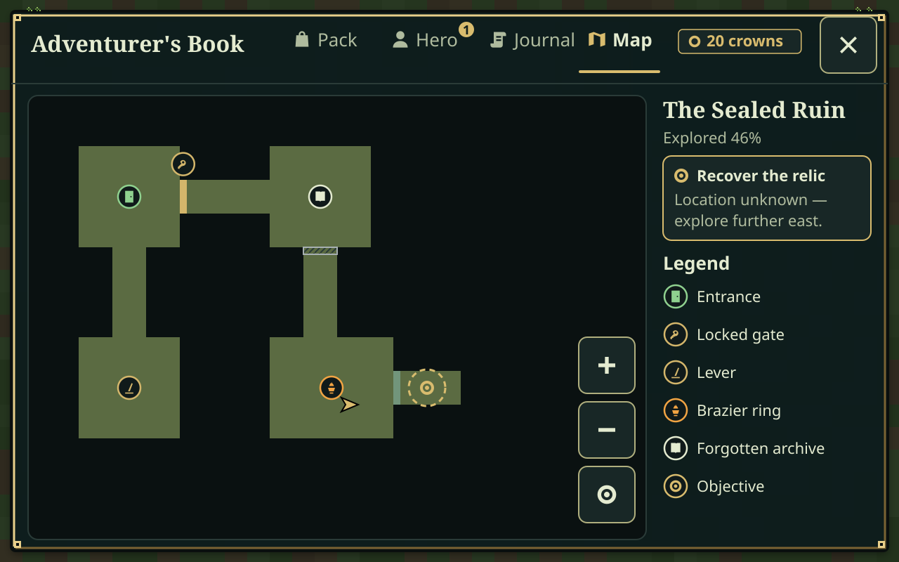 |
| 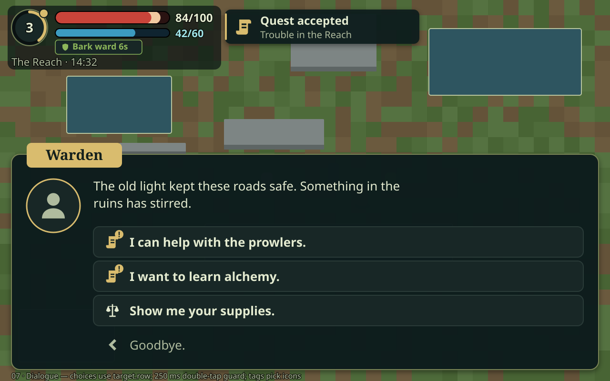 | 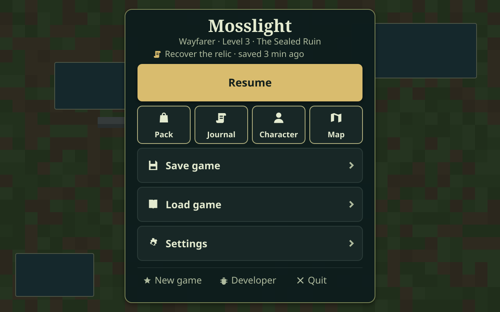 |
| 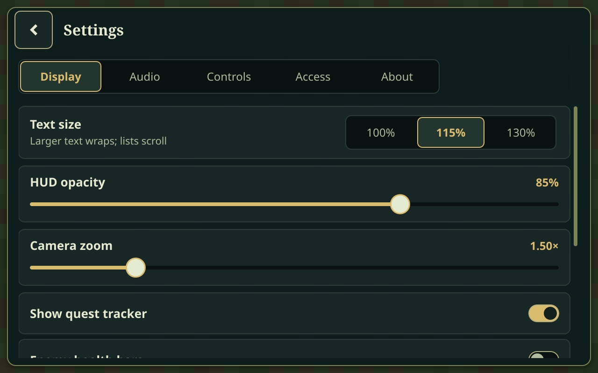 | 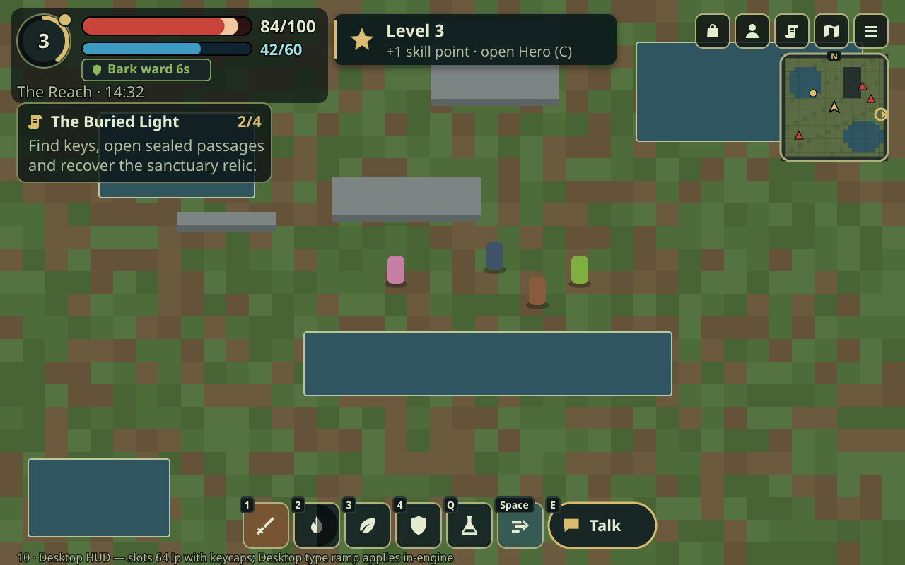 |
| 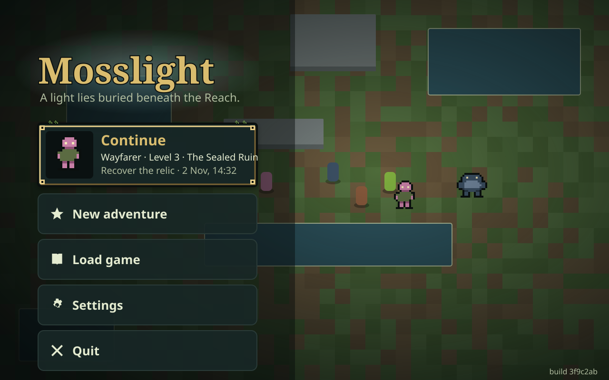 | 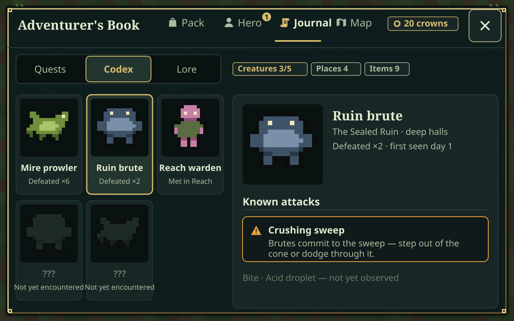 |
| 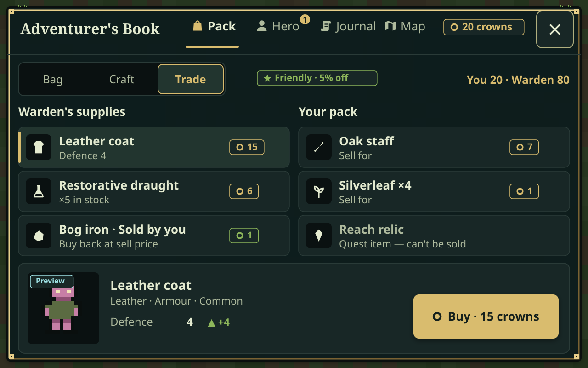 | 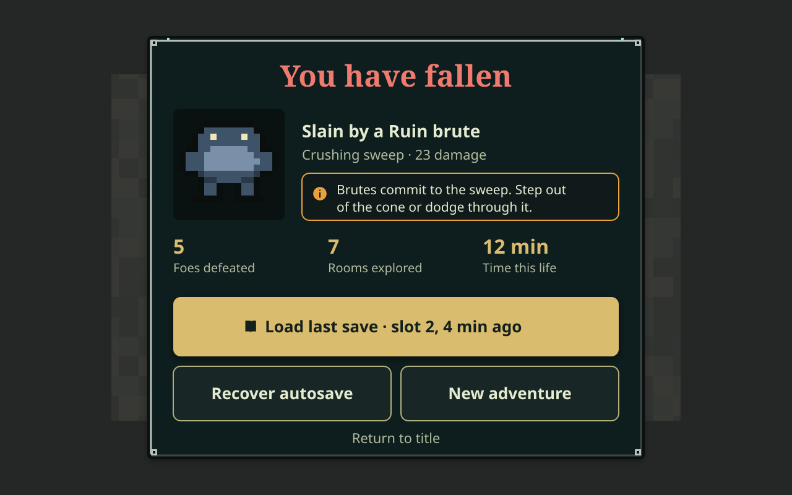 |
| 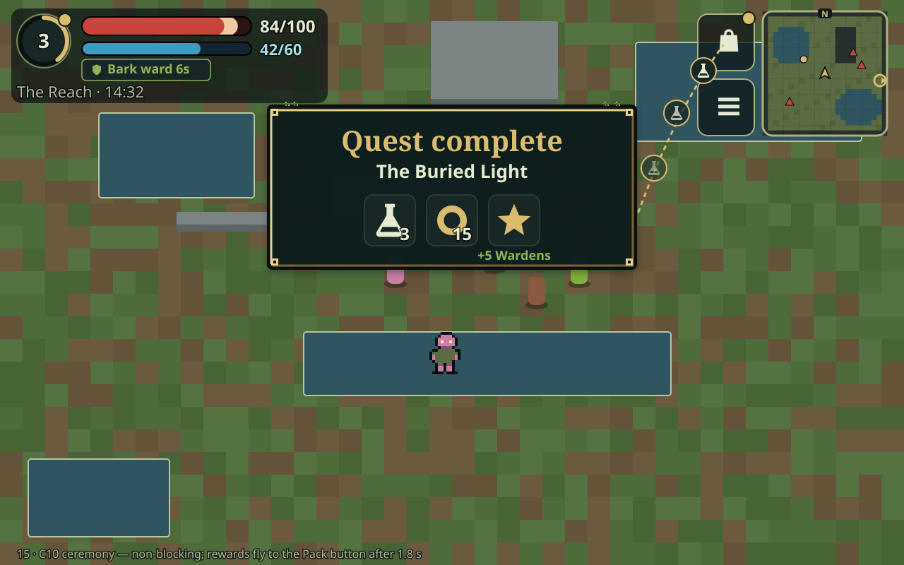 | |

---

## 1. Where we are starting from

Read these before changing anything: `game/ui/RpgUi.cs` (679 lines; the whole UI), `game/ui/MobileCombatControls.cs`, `game/ui/TouchStick.cs`, `game/ui/TouchScroll.cs`, the dialogue panel built inside `game/narrative/Narrative.gd` (`build_ui`, `advance`), and `Foundation` (`PresentationBlocked`, `GameplayBlocked`, `CanManageItems`, `Interact`, `_Notification`).

What the current screenshots (`docs/native-screenshots/*.png`) show, and what this PR fixes:

| Problem today | Consequence on a Galaxy S25 | Fixed in |
|---|---|---|
| Default font 20 logical px; panel buttons 56 px tall | 20 lp ≈ 10 sp text and 4.6 mm buttons, below Android's 14 sp / 7–9 mm guidance | 1 |
| HUD is one text line (`♥ 100/100 Mana 60/60 Lv 1 · XP 0/100 Idle`) | Health can't be read at a glance during combat | 2 |
| Every panel is a centred text list of "Verb · Noun" buttons | No item details, comparisons, icons, counts or reasons a craft/buy failed | 3 |
| Journal is one string; map legend is letter codes | Quest stages and map markers are hard to scan, and gates are distinguished only by colour | 3 |
| Pause menu mixes player and developer entries (workshop, collision overlay, feel lab, diagnostics) | Players see debugging tools; the menu needs scrolling | 1, 4 |
| Dialogue panel is a fixed 920×240 box at (180,300), unthemed, outside the safe area | Text and choices collide with the hotbar (see `dialogue.png`) | 4 |
| Android Back uses Godot's default `quit_on_go_back` | Back quits the game instead of closing a panel | 1 |
| `window/stretch/aspect` defaults to `keep` | ~300 physical px letterbox bars on each side of a 19.5:9 phone | 1 (decision D1) |
| Notifications are one bottom-left label that is overwritten | Loot, quest and level messages are lost | 2 |

## 2. Product vision and UX principles

**Look and feel: "Lantern & Moss".** Dark, slightly translucent slate-teal panels (the existing `#101A1A` family), aged-brass frames, parchment-gold highlights, moss green for success, a cool lumen cyan for magic and light seals, ember orange for the sword. The world is pixel art; the UI is crisp vector with chunky, readable silhouettes. It should frame the art, not compete with it.

Principles, in priority order. When two conflict, the higher one wins.

1. **Combat first.** Nothing that needs reading during a fight sits under a thumb or in the middle of the screen. Health is readable within 200 ms of a glance. No modal ever opens on its own during combat.
2. **Thumb-sized and safe.** Every touch target is at least **80 lp** (logical px; ≈ 6.6 mm on the S25) and list rows are **88 lp**. Gaps between adjacent targets are at least 12 lp. Everything stays inside the display safe area.
3. **One way in, one way out.** Every screen has a visible close/back control in the top-right corner. Esc and Android Back always go back exactly one level, never quit, and never act on gameplay.
4. **Show state and say why.** Disabled actions say why ("Needs 2 Silverleaf", "No room in pack", "3 s"). Counts, costs and comparisons are shown before a commitment, not after.
5. **Authority stays where it is.** The UI is a view plus command dispatcher. Gloot owns items, QuestSystem/`Narrative` owns quests, `World` owns actors and regions, and `Foundation` owns commands and blocking. The UI keeps **no** parallel copies of game state. Every screen rebuilds from live queries.
6. **Same structure on desktop and mobile.** One component tree with two densities (Touch and Desktop). Desktop adds hover, focus rings and key hints, but no extra screens.
7. **Accessible by default.** Never use colour alone (add an icon or shape too). Text ≥ 4.5:1 contrast. Reduced-motion and text-size settings. Nothing flashes more than 3 times per second.

## 3. Information architecture

```
HUD (always, during play)
├── Vitals (top-left)        → tap: Book ▸ Hero
├── Toast lane (top-centre)
├── Utility (top-right): [Book] [Menu]
├── Quest tracker (top-right, under utility)  → tap: Book ▸ Journal (tracked quest)
├── Stick (bottom-left)
└── Action cluster (bottom-right): Attack, Dodge, Ember, Mend, Draught, Interact (contextual)

Adventurer's Book  (I / C / J / M, HUD Book button, tracker, vitals)
├── Pack     ─ segmented: Bag | Craft | Trade (Trade only while a merchant is in range)
├── Hero     ─ stats, traits, reputation, abilities, skills
├── Journal  ─ segmented: Quests | Lore
└── Map

Pause  (Esc / Back with nothing open / HUD Menu)
├── Resume                        (labelled "Enter / Resume" — test contract)
├── Save game  ▸ Save/Load screen (3 slots)
├── Load game  ▸ Save/Load screen (3 slots + Recovery autosave)
├── Settings   ▸ Display | Audio | Controls | Accessibility | About
├── Pack · Journal · Character · Map   (shortcut row; replaces Pause with the Book — test contract)
├── New game   ▸ Confirm dialog
├── Developer tools ▸ (debug builds / --dev only; Part 4)
└── Quit       ▸ Confirm dialog (desktop only)

Dialogue (Narrative-driven bottom sheet; blocks gameplay; not part of the screen stack)
Defeat (non-blocking banner over the HUD; Pause promotes Load/Recover/New game)
```

Navigation rules (implemented in Part 1, used everywhere):

- **Screen stack.** At most one *root* screen (Book or Pause) plus stacked children (Settings, Save/Load, Confirm, Developer). `Back` pops one. `CloseAll` empties the stack.
- Opening the Book while Pause is open replaces Pause (existing behaviour, required by `ReviewChecks`). Opening Pause while the Book is open replaces the Book.
- A hotkey for a Book tab toggles: `I` with Pack showing closes the Book; `I` with Journal showing switches to Pack.
- Dialogue is not on the stack. While `Narrative.speaking` is true, Book and Pause cannot open (existing guard). Esc/Back during dialogue does nothing, because dialogue choices are deliberate.

## 4. Architecture overview (target state after Part 4)

```
game/ui/
  RpgUi.cs                  CanvasLayer root; public API façade (kept for tests/Foundation); owns HUD + ScreenHost
  Foundation/               (Part 1)
    UiTokens.cs             colours, spacing, radii, durations, type ramp (single source of truth)
    UiTheme.cs              builds the Godot Theme + type variations from tokens and density/text scale
    UiDensity.cs            Touch / Desktop profile, text scale, button scale, left-handed flag
    UiFrame.cs              logical safe rect (wraps MobileCombatControls.ToLogicalSafeArea), Changed event
    ScreenHost.cs           stack, scrim, transitions, Back handling, input cancellation on open
    UiScreen.cs             base class for screens
    UiIcons.cs              icon lookup (SVG textures in game/ui/icons/)
    UiProbe.cs              MOSSLIGHT_UI logging of control centres; verification helpers
    Components/             UiButton, IconButton, TabBar, Segmented, ListRow, ItemTile, StatBar,
                            Badge, Chip, SectionHeader, EmptyState, ConfirmDialog, Toggle, SliderRow
  Hud/                      (Part 2)
    HudRoot.cs, VitalsPanel.cs, ActionButton.cs, InteractButton.cs, QuestTracker.cs,
    ToastLane.cs, Banner.cs, DesktopHotbar.cs
  Screens/                  (Parts 1, 3, 4)
    BookScreen.cs (+ PackPage, CraftPage, TradePage, HeroPage, JournalPage, MapPage, RegionMap)
    PauseScreen.cs, SaveLoadScreen.cs, SettingsScreen.cs, DeveloperScreen.cs, ConfirmDialog.cs
  MobileCombatControls.cs   kept: action registry + versioned geometry (v2 in Part 2)
  TouchStick.cs, TouchScroll.cs  kept: restyled only
  icons/*.svg               monochrome 24-grid icons
  fonts/*                   OFL fonts + license (Part 1)
game/narrative/DialogueBalloon.gd   (Part 4) presentation for Narrative.gd's dialogue
game/settings/UserSettings.cs       (Part 4) user://settings.cfg; never part of game saves
```

C# namespace stays `Mosslight`. Default to building controls in code, as the project already does. `.tscn` scenes are allowed where they genuinely simplify a layout (D6). Keep each file focused (target < 300 lines).

## 5. Current dependencies (change freely, but deliberately)

These are relied upon by `game/tests/*`, `tools/android-smoke.py`, `tools/verify.py` and CI. None of them is a creative limit. Any of them may change when the design calls for it (CREATIVE_DIRECTION does change several). When one changes, update its consumer **in the same commit** so it checks the new intent, and record the change in that part's handoff.

**Engine and project**
- Godot 4.6.1 .NET, .NET SDK 9.0.203, GL Compatibility renderer, landscape, `canvas_items` stretch, 1280×800 base. Android ARM64 build and x86_64 emulator smoke must stay green.
- The UI is a `CanvasLayer` child of `Foundation` and is created after `Reset()` (see `Foundation._Ready`).

**Public `RpgUi` API used by tests and tools** (keep the signatures; the internals may change):
`App`, `MobileLayout`, `Stick`, `ActionControl(id)`, `CombatControls`, `StatusRect`, `VerificationSafeArea`, `Layout()`, `Update()`, `Notify(string)`, `ClosePanels()`, `HideMenu()`, `Menu()`, `MenuOpen`, `BlocksInput`, `PauseForVerification()`, `CancelActionTouches()`, `Inventory()`, `Journal()`, `Character()`, `Map()`, `Workshop()`, `FeelLab()`, `Diagnostics()`, `SaveSlot`, `Muted`, `SettingsOpen`.

**Input ownership** (`docs/COMBAT_CONTROLS.md` "Part 4 mobile layout"):
- Action buttons activate on release inside the original touch target. Ownership never transfers between buttons. Owned drags are consumed. Emulated-mouse events over gameplay controls are suppressed. Real mouse input and native menu controls keep working.
- Opening any modal, a resize/`Layout()`, or focus loss synchronously clears stick and button ownership (`CancelActionTouches`, `Stick.Cancel`, `TouchMovement = 0`, `World.CancelPlayerDodge()`).
- `TouchScroll` semantics: a swipe that starts on a button scrolls and never clicks. A canceled touch never clicks. Sliders, OptionButtons and the scrollbar get native input.
- Primary hitboxes never change size with label or cooldown text (`attack.Text="Attack\n999.9s"` check).
- Action IDs: `attack, dodge, ember, mend, potion, interact, inventory, menu` (mobile), plus `journal, character, map` on desktop. Android logs `MOSSLIGHT_CONTROL version=N id=… x=… y=…` (physical px) on every mobile `Layout()`.

**Blocking and authority**
- `Foundation.PresentationBlocked` = no UI, suspended, `ui.BlocksInput`, or speaking. `GameplayBlocked` adds death. `CanManageItems` must remain false while Pause (`MenuOpen`), dialogue, focus loss or death applies. Book screens may *show* while blocked; mutations go through `App.ManageItem(...)`.
- All item operations go through `Items`/`ItemService.gd`, quest operations through `Narrative`, progression through `Progression`, and saves through `Persistence`. Do not add parallel stores or extra save fields for UI state. Settings live in `user://settings.cfg` (Part 4).

**Test-visible text and structure** (update the tests in the same commit if any of these change):
- Pause contains a visible Button with text exactly `Enter / Resume`, and buttons `Pack`, `Journal`, `Character`, `Map` (`ReviewChecks` route loop). Pressing them leaves the player in gameplay after `ClosePanels()`.
- On mobile, some visible `ScrollContainer` inside `RpgUi` must scroll by ≥ 60 px under a 180 px swipe started on a button row while `MenuOpen` stays true (`VisualChecks`). After Part 1 the pause list may fit without scrolling. In that case, move this check to a guaranteed-overflow list (Settings ▸ Accessibility or Developer tools) and keep its intent.
- `Narrative.choices` is a `VBoxContainer` whose children are the response `Button`s (plus a `Continue` button), and `Narrative.speaking` is the dialogue flag. Locked choices are hidden or disabled, never rendered with `[if` text. Android logs `MOSSLIGHT_DIALOGUE_CHOICE text=… x=… y=…`.
- `tools/android-smoke.py` taps fixed 1280×800 coordinates: `(640,178)` = Enter/Resume on the start/resume menu, and `(640,566)` = New game. Part 1 **replaces** these with logged coordinates (`MOSSLIGHT_UI id=… x=… y=…`) and must update the script in the same commit.

**Verification-mode determinism**
- Under `Foundation.VerificationMode` (`--test`, `--visual-check`, `--gameplay-check`, `--adventure-check`, `--adventure-visual`): all transitions take 0 s, typewriter text is instant, toasts are not time-gated for capture, user settings are **not** loaded (defaults only), and the first-run hint is suppressed. Screenshots must be identical run-to-run.

## 6. Cross-part dependencies

```
Part 1 ──► Part 2 (uses tokens, components, icons, UiFrame, toasts host)
   │  └──► Part 3 (uses ScreenHost, Book shell, ListRow/ItemTile/Segmented)
   └─────► Part 4 (uses ScreenHost, theme for Narrative, components for Settings)
Part 2 ─► Part 4 (left-handed mirror + HUD opacity settings act on v2 geometry)
Part 3 ─► Part 2 (quest tracker reuses Narrative.journal_entries() added in Part 3 — build it in Part 2 if Part 2 lands first)
```

Recommended order: 1 → 2 → 3 → 4, each as a series of small commits on `feat/mobile-ui-ux-overhaul`. Each part ends with a green `tools/verify.py --headless`, a refreshed `--visual` capture set (desktop and `--mobile`) and a handoff file `docs/PR7_PARTn_HANDOFF.md` written in the same style as `docs/PR5_PART4_HANDOFF.md`: what changed, what authority is unchanged, actual verification results, and known limits. Do not tick a PR milestone until its handoff exists.

## 7. Decisions

**All resolved; see [CREATIVE_DIRECTION.md § Resolved decisions](CREATIVE_DIRECTION.md#resolved-decisions-replaces-readme-7).** The original recommendations are kept below for context. D3 now uses the v3 IDs and D5 is reversed: selling is in.

| # | Decision | Recommendation |
|---|---|---|
| D1 | `window/stretch/aspect`: keep (letterbox) vs `expand` | **`expand`**. Phones gain ~35% horizontal space and lose the bars. Desktop 1280×800 is unchanged. Costs: more world visible means more actors are drawn, so re-measure `PR4_PART4_PERFORMANCE`-style frames on mobile. All UI is safe-rect driven and adapts. Smoke taps must use logged coordinates (Part 1 does this). If performance regresses, fall back to `keep` with no UI changes. |
| D2 | Bundled fonts | **Atkinson Hyperlegible** (body/UI, OFL) + **Alegreya SC Bold** (headings, OFL). If they can't be vendored (network/licensing), use Godot's default font with the same type ramp. |
| D3 | Action layout v2 (arc) vs v1 reskin | **v2 arc** (Part 2 §3). Bigger secondary buttons (92 vs 72 lp tall) and a thumb-arc arrangement. The geometry version bumps to 2; smoke regexes update. |
| D4 | Developer tools visibility | Visible from Pause in **debug builds** (the current APKs are debug) or with `--dev`, as one "Developer tools" entry. Never shown in release exports. |
| D5 | Selling to merchants | **Out of scope** (no economy rules exist). The Trade tab buys only, as today. |
